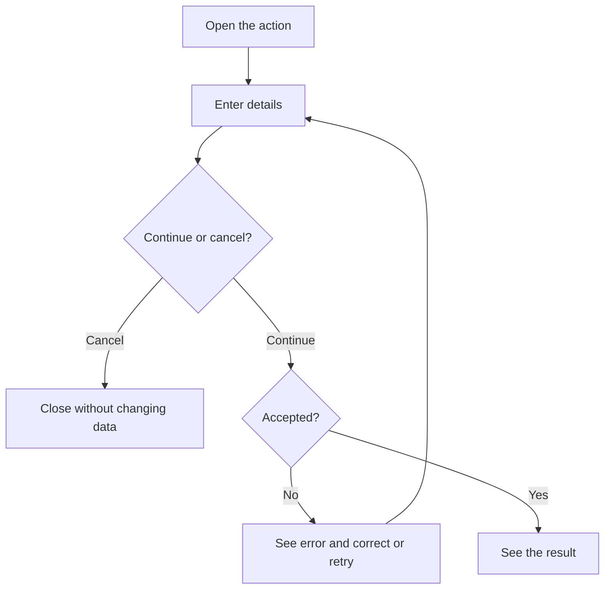
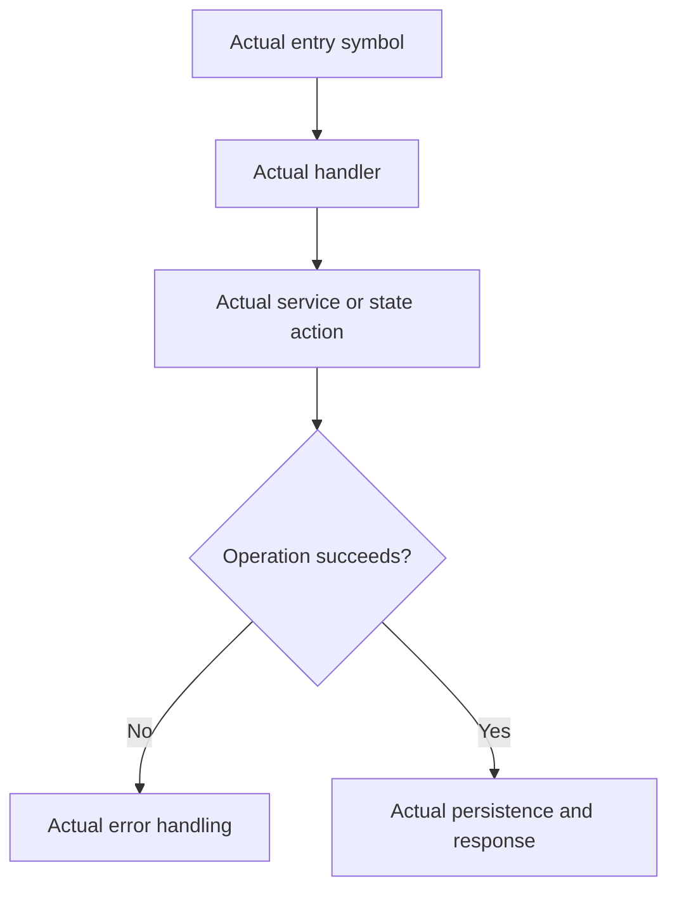

# User story template

A story records one meaningful user or operator action and its purpose. Replace all bracketed text and sample symbols with source-backed repository details. Keep this document portable and independent of private workflow files.

## Story example

Use [US-ACCESS-02](US-ACCESS-02-enter-scoped-route.md) as the repository-specific example. Copy its structure and adapt both diagrams to the new outcome.

## Story format

````markdown
# US-AREA-NN — Action title

As a [role], I want to [action] so that [useful outcome].

**Status:** [Current / Hidden / Removed / Demo / Operator / Planned; explain unavailable entry]
**Access:** [Actual roles and relevant conditions]
**Entry:** [Screen, route and exact visible control, API, or explicitly unavailable]
**Documentation:** [Relevant guide](../docs/README.md), or state that none exists
**Source:** [Entry implementation](../src/define.ts)
**Coverage:** [Relevant test, optional](../tests/middleware.spec.ts)

## Acceptance criteria

| Field                              | Control                         | Required/default/conditions                                                                   |
| ---------------------------------- | ------------------------------- | --------------------------------------------------------------------------------------------- |
| [Exact visible label or API input] | [Control type or API parameter] | [Required/optional, default, limits, options, dependent choices, visibility, read-only state] |

- [Observable success result.]
- [Relevant cancellation, refusal and failure behavior.]

## User flow



## Code flow

Scope: [Whole path, or explicitly named shared/host-owned boundary.]



**Code references:** [Entry](../src/define.ts), [Handler](../middleware/main.ts)
````

## Actions without input fields

Replace the field table with a short list of controls and their visible results. Do not create empty or artificial field rows. For API/package actions with no UI, list the actual inputs and returned values instead. Include confirmation controls and relevant cancellation or failure outcomes. Example: `- **Today** returns the timeline to the start of the current week in the configured time zone.` Replace that sample with a control that exists in the repository.

## Writing and maintenance rules

- Use one story per meaningful outcome. An inseparable set of controls may share a story; independently useful actions deserve their own. Create and edit are distinct actions.
- Include every relevant field, including conditional and read-only fields. Record exact labels, required/optional state, defaults, limits, available options and dependent choices. For dynamic choices, describe their source and filtering rules rather than listing transient data.
- Link an identical shared field list where useful and describe create/edit differences locally. Do not make readers chase several links to reconstruct a form.
- Keep acceptance criteria concise and observable. Avoid detailed test scripts and exhaustive backend guarantees; keep those in tests and authoritative product contracts.
- Keep identifiers and filenames stable. Add the next unused identifier within the area. Retain intent and mark availability when a feature disappears, unless retirement is explicitly authorized.
- Use the availability definitions below. Explain unavailable entries and identify historical or intended controls clearly. Retention does not promise restoration or authorize new functionality.
- An optional **Coverage:** link identifies supporting tests; it does not claim they were run. Keep runtime results separate from source-reviewed availability.
- Verify source rather than inheriting stale copy. Update index, coverage, shared reference and gaps alongside affected stories.
- Record differences between agreed targets and current implementation in the gaps record without silently changing either. “New” in coverage means newly documented, not newly implemented.

## Availability definitions

| Status   | Meaning                                                                 |
| -------- | ----------------------------------------------------------------------- |
| Current  | Exposed, subject to stated roles, configuration and conditions          |
| Hidden   | Implementation remains but its ordinary entry or trigger is unavailable |
| Removed  | Historical capability has no current product entry                      |
| Demo     | Available only in the specified demo context                            |
| Operator | Installation, hosting or recovery outside the ordinary application UI   |
| Planned  | Agreed target without an ordinary implemented journey                   |

Read Status with Access and Entry. A configured switch is a condition, not proof of removal. Current describes availability, not a browser test result. Preserve equivalent repository status semantics and explain their mapping if they differ.

## Diagram conventions

- Every story has User flow and Code flow sections, each containing a Mermaid flowchart. The first uses screens/actions/decisions/outcomes a person understands; the second names actual implementation symbols. Link supporting files under Code references.
- Keep diagrams focused on the action. Include meaningful choices, cancellation, refusal, failure and recovery where they affect the journey; avoid repeating every validation or security rule.
- Trace producers and consumers: entry, handler, state or service, persistence where applicable and resulting response. A retained component or setter alone does not prove a reachable journey.
- Distinguish server writes, local preferences and read-only actions. Verify the demo's actual path. Do not infer server authorization from hidden controls.
- Code labels must name existing symbols or explicitly identify absent/intended controls. State the scope when a diagram stops at a shared boundary.
- For Hidden, Removed or Planned features, label the intended user flow as unavailable. Show the actual missing entry/trigger and retained support in the code flow without implying execution.
- Reconcile labels and branches against source. Parse changed diagrams and inspect representative rendering; report any unavailable check. Syntax validity does not establish behavioral accuracy or prove a browser journey was exercised.
