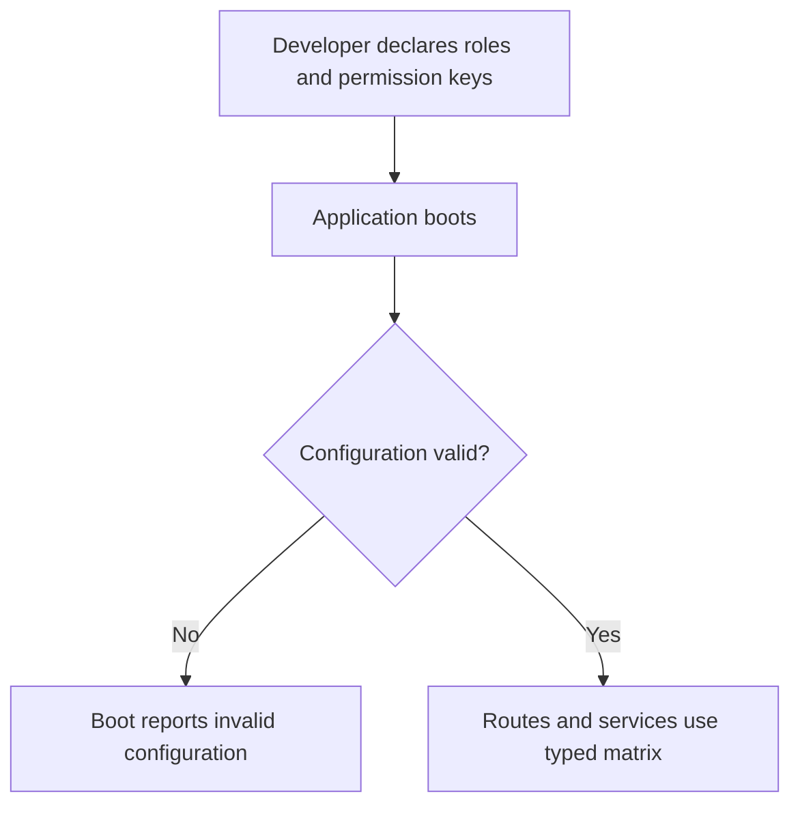
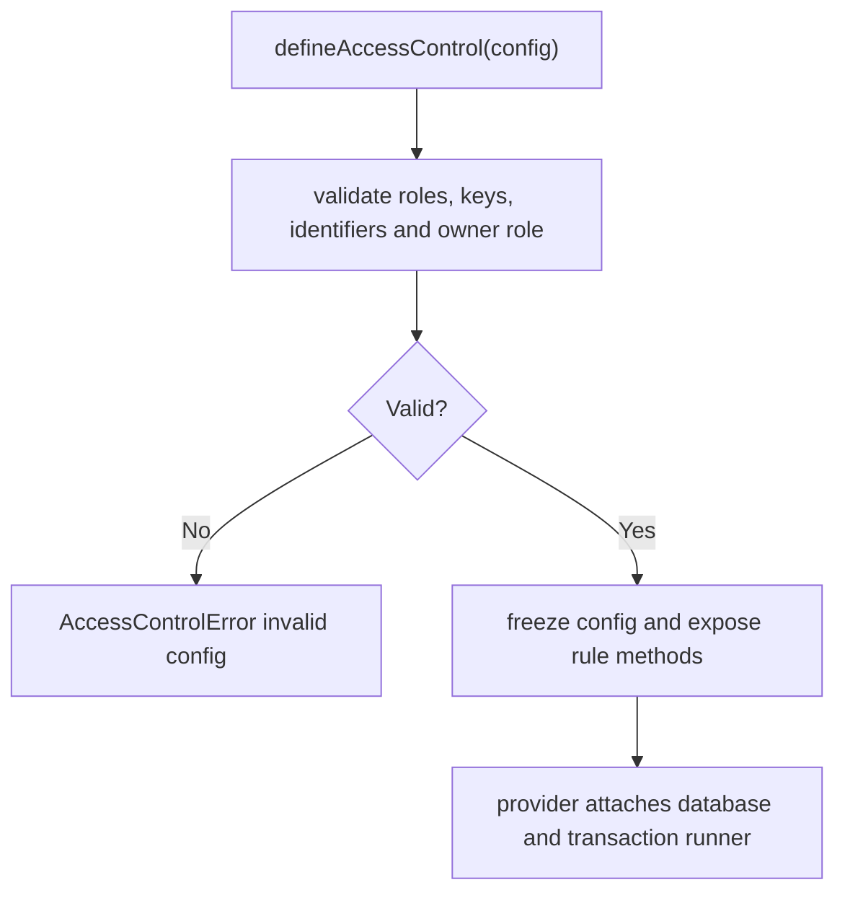

# US-ACCESS-01 — Declare ordered roles and permission keys

As an application developer, I want to declare ordered roles and permission keys so that permission names and role rules stay consistent across the application.

**Status:** Current after provider/configuration setup
**Access:** Application config author declares a non-empty ordered role list and maps permission keys to roles.
**Entry:** `config/access_control.ts` calls `defineAccessControl`; provider attaches database runner at boot.
**Documentation:** [roles.md](../docs/guide/roles.md)
**Source:** [src/define.ts](../src/define.ts)
**Coverage:** [`tests/define.spec.ts`](../tests/define.spec.ts)

## Acceptance criteria

- Roles are ordered lowest to highest. Role names match `^[a-z][a-z0-9_-]*$`, have at most 32 characters and are not duplicated; resource and action names match `^[a-z][a-zA-Z0-9]*$`.
- The reserved keys `members:list`, `members:manage` and `invitations:manage` must be declared, each mapped to a listed role.
- Optional owner role is last and has another role below it. Users, scope and memberships table names are plain SQL identifiers; `membershipsTable` defaults to `memberships`; key types are `integer`, `string` or `uuid`.
- Typed keys and runtime helpers expose permission/rank/assignment/management predicates from the same matrix.

## User flow

## Code flow

Scope: package behavior; the host owns team records, page rendering, route placement, record-level policy, and trusted operations outside the package callback.

**Code references:** [configuration](../src/define.ts), [rules](../src/rules.ts), [types](../src/types.ts)
