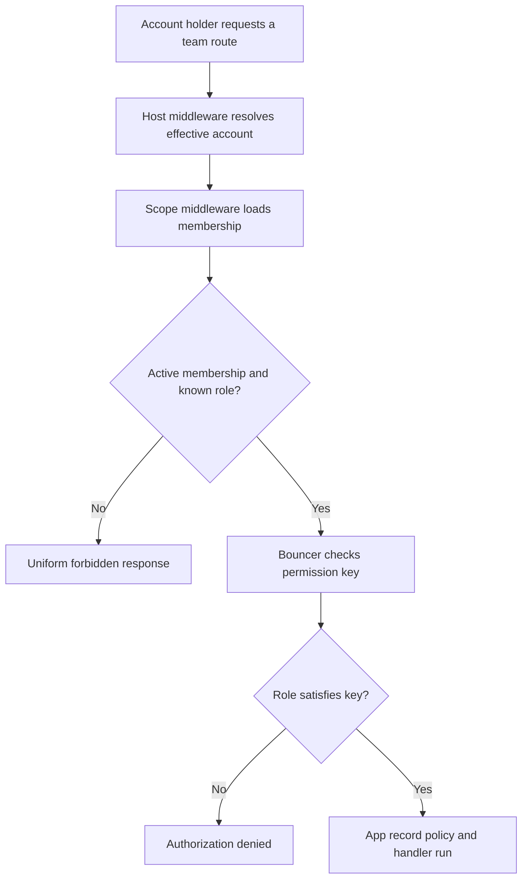
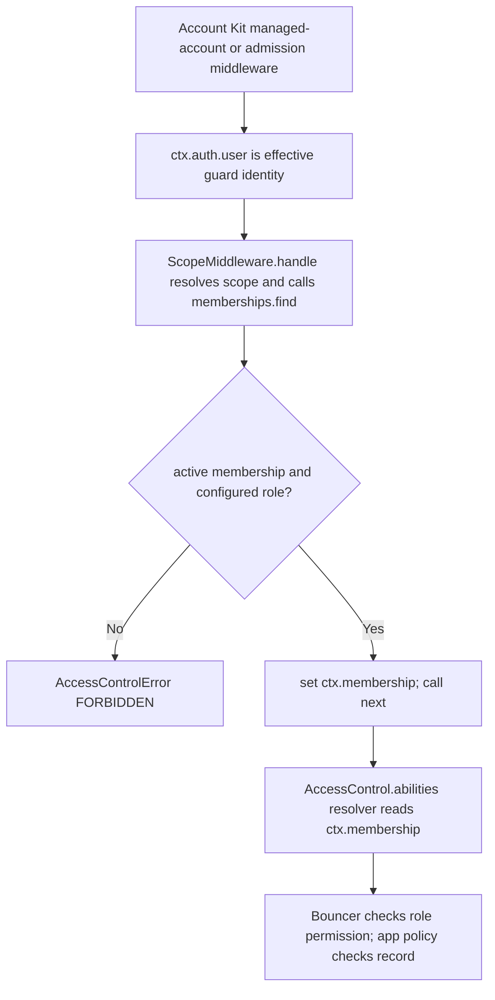

# US-ACCESS-02 — Enter an authorized team-scoped route

As an authenticated account holder, I want to enter an authorized team-scoped route so that each request is checked against the current account and scope.

**Status:** Current when host Account Kit/authentication and scope middleware are mounted
**Access:** Effective user from `ctx.auth.user`; must have active membership and configured role. Account Kit must precede scope where credential revision, activation or admission checks are required.
**Entry:** Host route uses Account Kit managed-account/admission middleware, then `middleware.scope()`; Bouncer checks permission key.
**Documentation:** [bouncer.md](../docs/guide/bouncer.md)
**Source:** [middleware/main.ts](../middleware/main.ts)
**Coverage:** [`tests/middleware.spec.ts`](../tests/middleware.spec.ts)

## Acceptance criteria

- Scope defaults to `ctx.params.scopeId`; host may supply `resolveScope`.
- Missing effective user, malformed scope, no membership, suspended membership or unknown role fails with the same forbidden error.
- Success sets `ctx.membership`; generated ability resolves it at check time and matches it to Bouncer subject.
- Permission ability answers role-level permission only; record-level policies remain app-owned.

## User flow

## Code flow

Scope: package behavior; the host owns team records, page rendering, route placement, record-level policy, and trusted operations outside the package callback.

**Code references:** [scope middleware](../middleware/main.ts), [abilities](../src/abilities.ts), [guide](../docs/guide/bouncer.md)
