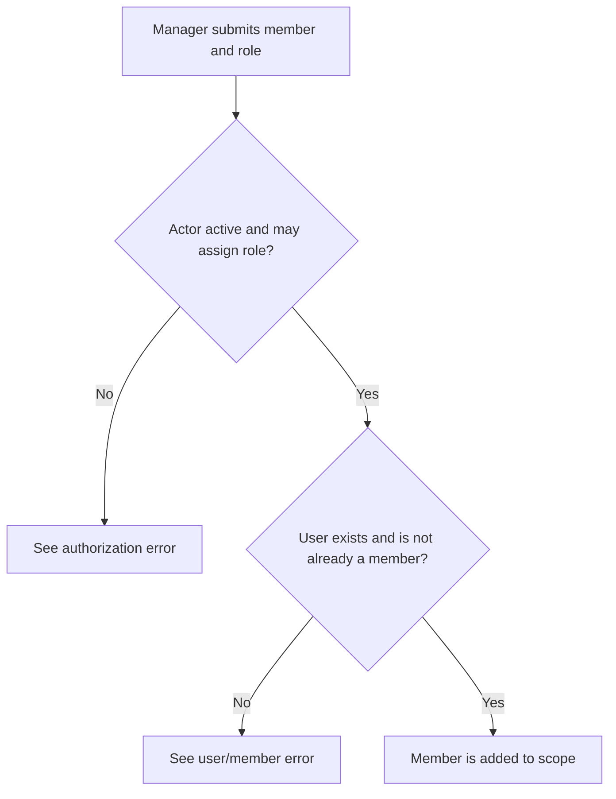
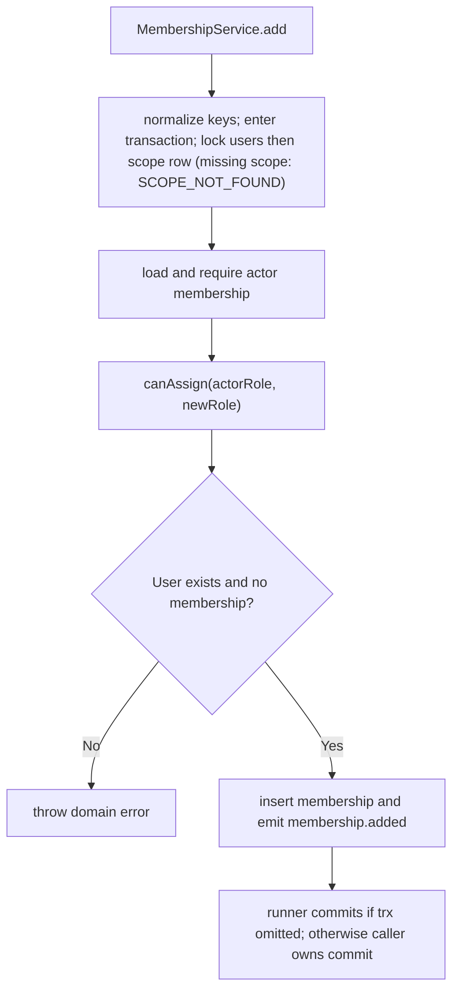

# US-ACCESS-03 — Add a member to a scope

As an active scope manager, I want to add a member to a scope so that the added person receives an assignable role.

**Status:** Current
**Access:** Active actor membership with `members:manage`; actor can assign the requested known non-owner role at or below own rank; target user row must exist.
**Entry:** Host member-management route calls `memberships.add({ actor, scopeId, userId, role })`.
**Documentation:** [memberships.md](../docs/guide/memberships.md)
**Source:** [src/memberships.ts](../src/memberships.ts)
**Coverage:** [`tests/memberships.spec.ts`](../tests/memberships.spec.ts)

## Acceptance criteria

- Add is an actor-authorized membership write in the Kit transaction/lock process.
- Unknown role, unknown user, existing member, inactive/missing actor, self-management or role above actor is refused. A scope row that does not exist is refused with `E_ACCESS_CONTROL_SCOPE_NOT_FOUND` (404) when the scope is locked, before the actor is checked.
- Successful add creates membership and emits `membership.added` inside the same transaction.

## User flow

## Code flow

Scope: package behavior; the runner commits when `input.trx` is omitted; supplied transactions remain caller-owned and may later roll back; the host owns team records, page rendering, route placement, record-level policy, and trusted operations outside the package callback.

**Code references:** [add operation](../src/memberships.ts), [rules](../src/rules.ts)
