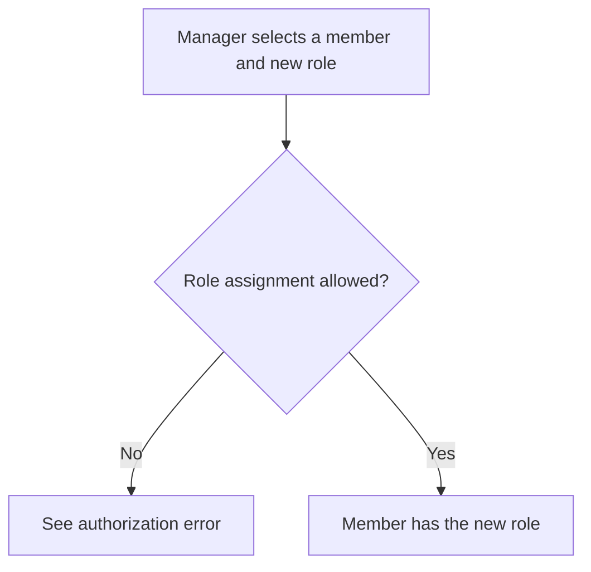
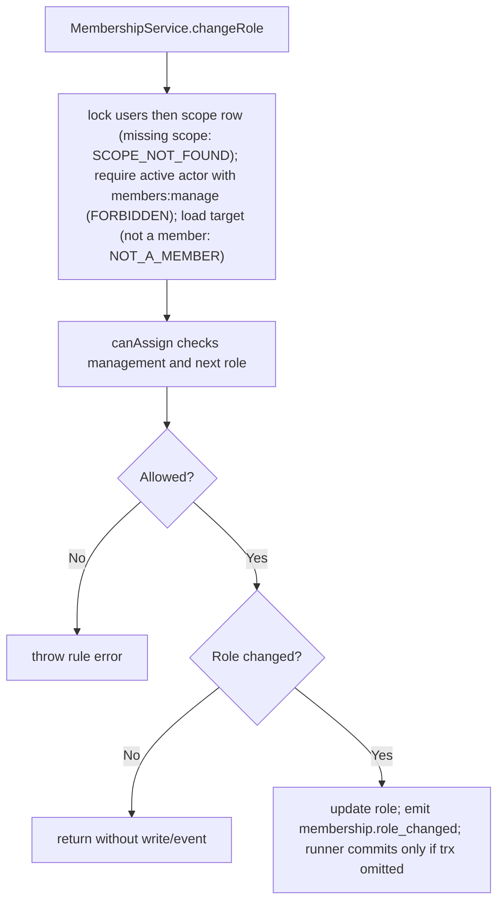

# US-ACCESS-04 — Change a member's role

As an active scope manager, I want to change a member role so that a member’s responsibilities match the actor’s authority.

**Status:** Current
**Access:** Actor must pass `members:manage`; target cannot be self or owner, and assigned role must be known, non-owner and no higher than actor.
**Entry:** Host member route calls `memberships.changeRole({ actor, scopeId, userId, role, trx? })`.
**Documentation:** [memberships.md](../docs/guide/memberships.md)
**Source:** [src/memberships.ts](../src/memberships.ts)
**Coverage:** [`tests/memberships.spec.ts`](../tests/memberships.spec.ts)

## Acceptance criteria

| Field     | Control              | Required/default/conditions                                                                                          |
| --------- | -------------------- | -------------------------------------------------------------------------------------------------------------------- |
| `actor`   | API input `{ id }`   | Required; the acting user, who must be an active member of the scope with `members:manage`.                          |
| `scopeId` | API input            | Required; normalised to the configured scope key type.                                                               |
| `userId`  | API input            | Required; the member whose role changes. Not a member: `E_ACCESS_CONTROL_NOT_A_MEMBER` (404), after the actor check. |
| `role`    | API input            | Required; the next role. Must be known, non-owner and no higher than the actor.                                      |
| `trx`     | Optional transaction | Omitted: the runner opens and commits one. Supplied: the caller owns commit and rollback.                            |

- Role change is refused for unknown roles, self, owner target, higher-ranked target or rank above actor; a target who is not a member is refused with `NOT_A_MEMBER`, and a scope row that does not exist with `E_ACCESS_CONTROL_SCOPE_NOT_FOUND` (404).
- No-op role change does not write or emit an event.
- Successful change writes new role and emits `membership.role_changed` transactionally.

## User flow

## Code flow

Scope: package behavior; the runner commits when `input.trx` is omitted; supplied transactions remain caller-owned and may later roll back; the host owns team records, page rendering, route placement, record-level policy, and trusted operations outside the package callback.

**Code references:** [changeRole](../src/memberships.ts), [canAssign](../src/rules.ts)
