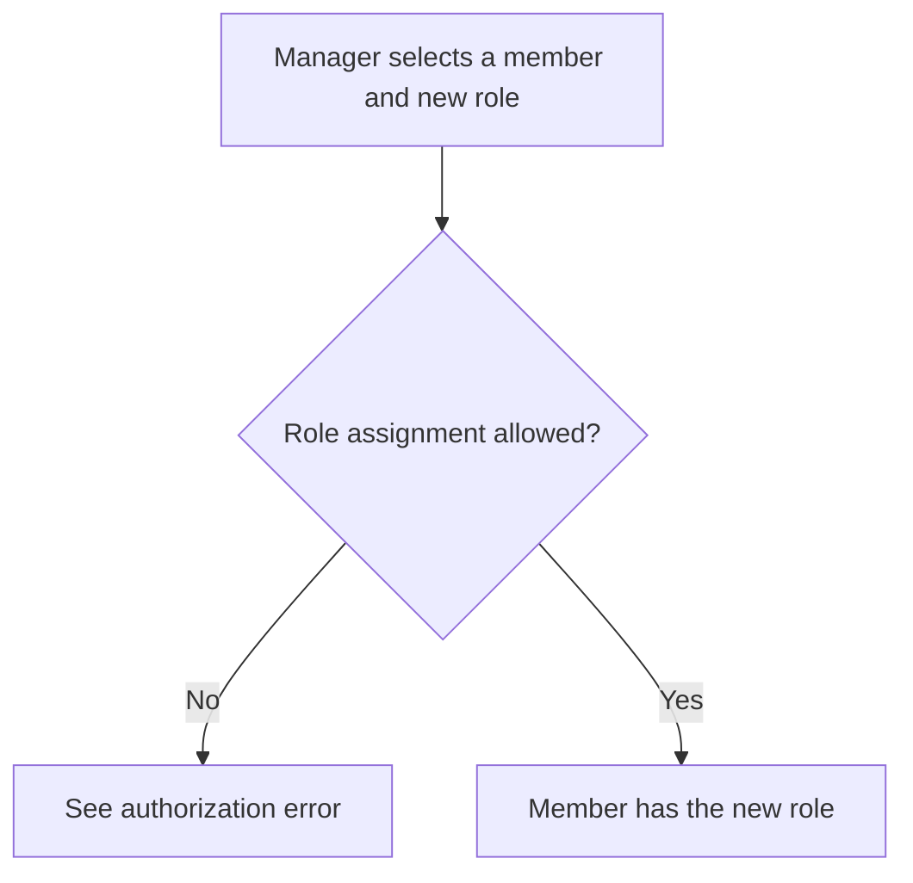
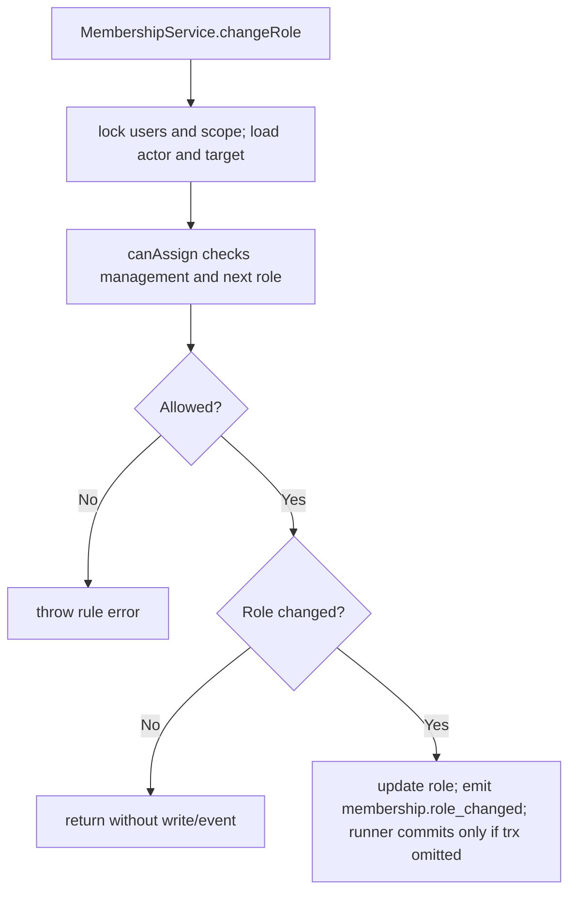

# US-ACCESS-04 — Change a member role

As an active scope manager, I want to change a member role so that a member’s responsibilities match the actor’s authority.

**Status:** Current
**Access:** Actor must pass `members:manage`; target cannot be self or owner, and assigned role must be known, non-owner and no higher than actor.
**Entry:** Host member route calls `memberships.changeRole(...)`.
**Documentation:** [memberships.md](../docs/guide/memberships.md)
**Source:** [src/memberships.ts](../src/memberships.ts)
**Coverage:** [`tests/memberships.spec.ts`](../tests/memberships.spec.ts)

## Acceptance criteria

- Role change is refused for unknown roles, self, owner target, higher-ranked target or rank above actor.
- No-op role change does not write or emit an event.
- Successful change writes new role and emits `membership.role_changed` transactionally.

## User flow

## Code flow

Scope: package behavior; the runner commits when `input.trx` is omitted; supplied transactions remain caller-owned and may later roll back; the host owns team records, page rendering, route placement, record-level policy, and trusted operations outside the package callback.

**Code references:** [changeRole](../src/memberships.ts), [canAssign](../src/rules.ts)
