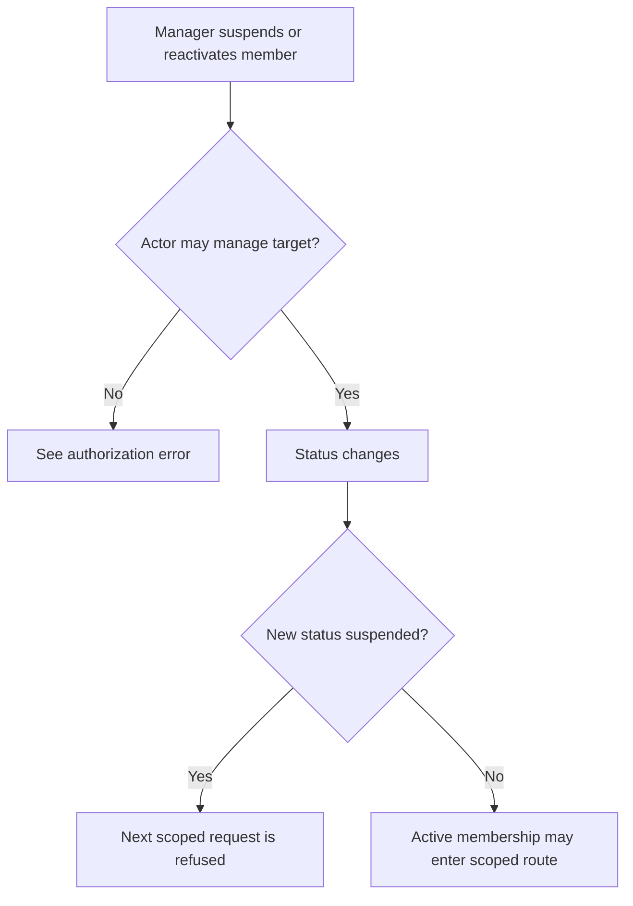
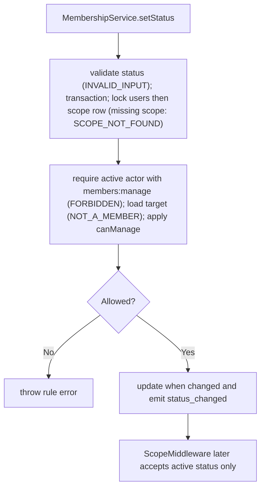

# US-ACCESS-05 — Suspend or reactivate a member

As an active scope manager, I want to suspend or reactivate a member so that scoped access can be suspended or restored deliberately.

**Status:** Current
**Access:** Actor must pass `members:manage`; cannot manage self, owner, or higher-ranked target.
**Entry:** Host member route calls `memberships.setStatus({ actor, scopeId, userId, status, trx? })`.
**Documentation:** [memberships.md](../docs/guide/memberships.md)
**Source:** [src/memberships.ts](../src/memberships.ts)
**Coverage:** [`tests/memberships.spec.ts`](../tests/memberships.spec.ts)

## Acceptance criteria

| Field     | Control              | Required/default/conditions                                                                                                |
| --------- | -------------------- | -------------------------------------------------------------------------------------------------------------------------- |
| `actor`   | API input `{ id }`   | Required; the acting user, who must be an active member of the scope with `members:manage`.                                |
| `scopeId` | API input            | Required; normalised to the configured scope key type.                                                                     |
| `userId`  | API input            | Required; the member to suspend or reactivate. Not a member: `E_ACCESS_CONTROL_NOT_A_MEMBER` (404), after the actor check. |
| `status`  | API input            | Required; `active` or `suspended`. Any other value: `E_ACCESS_CONTROL_INVALID_INPUT` (422), before locking.                |
| `trx`     | Optional transaction | Omitted: the runner opens and commits one. Supplied: the caller owns commit and rollback.                                  |

- Supported statuses are `active` and `suspended`.
- Self, owner, unknown-role and rank restrictions refuse the change. A target who is not a member is refused with `NOT_A_MEMBER`, and a scope row that does not exist with `E_ACCESS_CONTROL_SCOPE_NOT_FOUND` (404).
- A no-op status update emits no event; a change emits `membership.status_changed`. Suspended users are denied by scope middleware.

## User flow

## Code flow

Scope: package behavior; the host owns team records, page rendering, route placement, record-level policy, and trusted operations outside the package callback.

**Code references:** [setStatus](../src/memberships.ts), [scope middleware](../middleware/main.ts)
