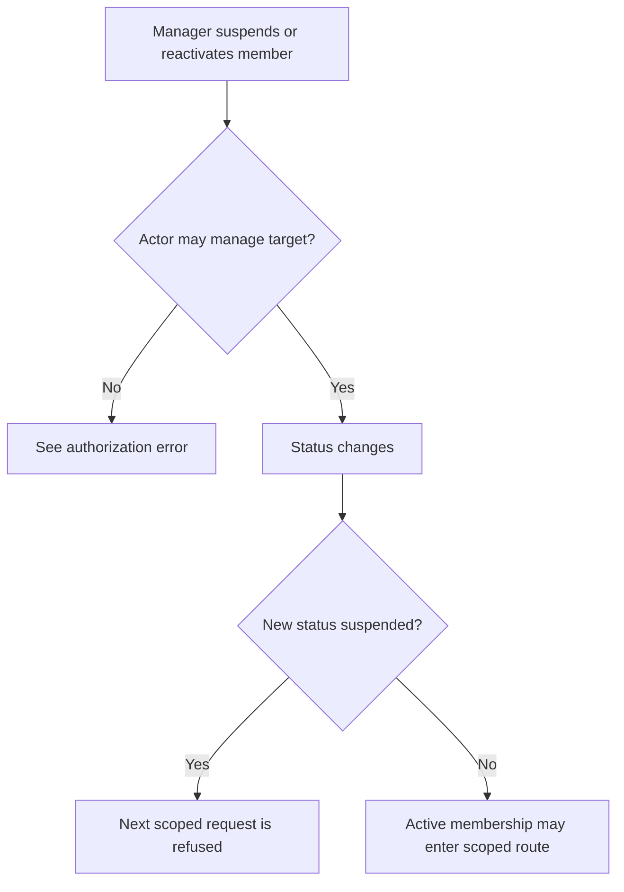
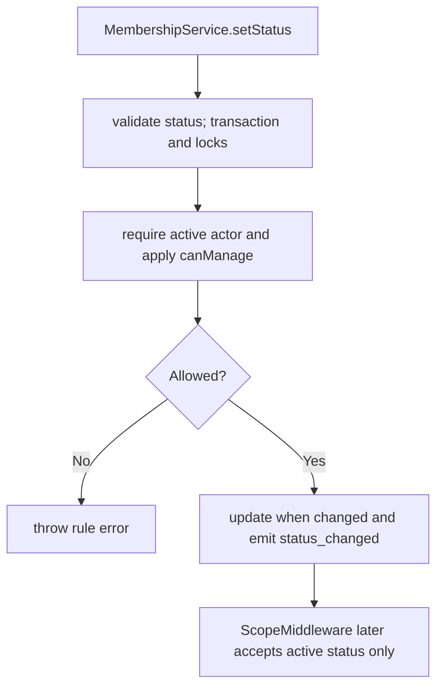

# US-ACCESS-05 — Suspend or reactivate a member

As an active scope manager, I want to suspend or reactivate a member so that scoped access can be suspended or restored deliberately.

**Status:** Current
**Access:** Actor must pass `members:manage`; cannot manage self, owner, or higher-ranked target.
**Entry:** Host member route calls `memberships.setStatus(...)`.
**Documentation:** [memberships.md](../docs/guide/memberships.md)
**Source:** [src/memberships.ts](../src/memberships.ts)
**Coverage:** [`tests/memberships.spec.ts`](../tests/memberships.spec.ts)

## Acceptance criteria

- Supported statuses are `active` and `suspended`.
- Self, owner, unknown-role and rank restrictions refuse the change.
- A no-op status update emits no event; a change emits `membership.status_changed`. Suspended users are denied by scope middleware.

## User flow

## Code flow

Scope: package behavior; the host owns team records, page rendering, route placement, record-level policy, and trusted operations outside the package callback.

**Code references:** [setStatus](../src/memberships.ts), [scope middleware](../middleware/main.ts)
