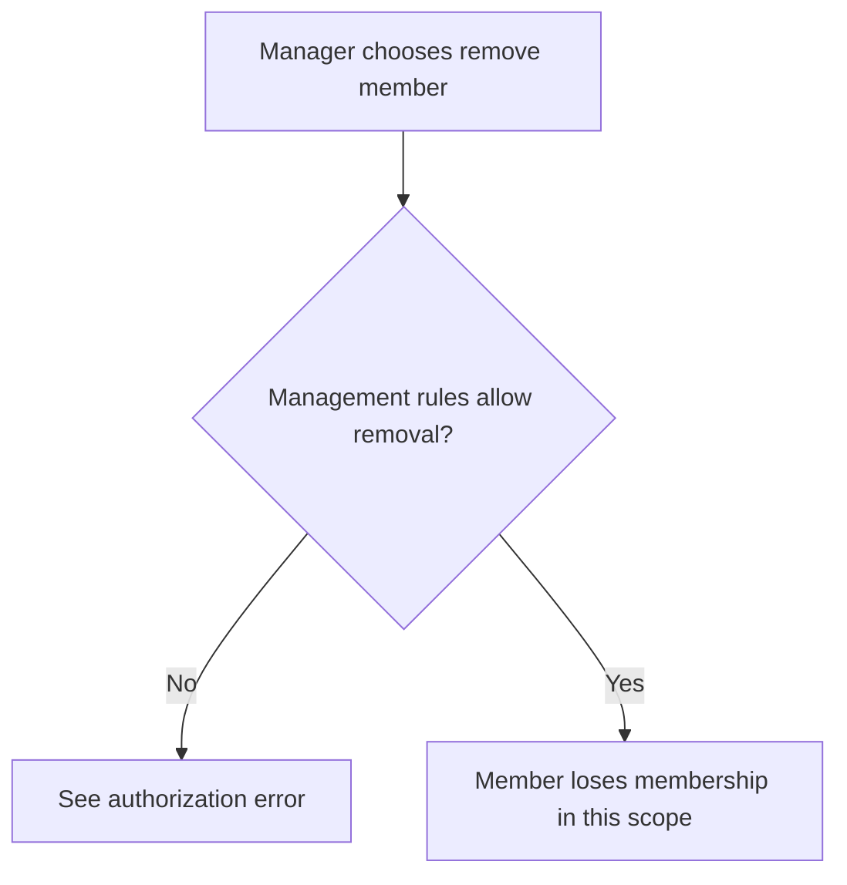
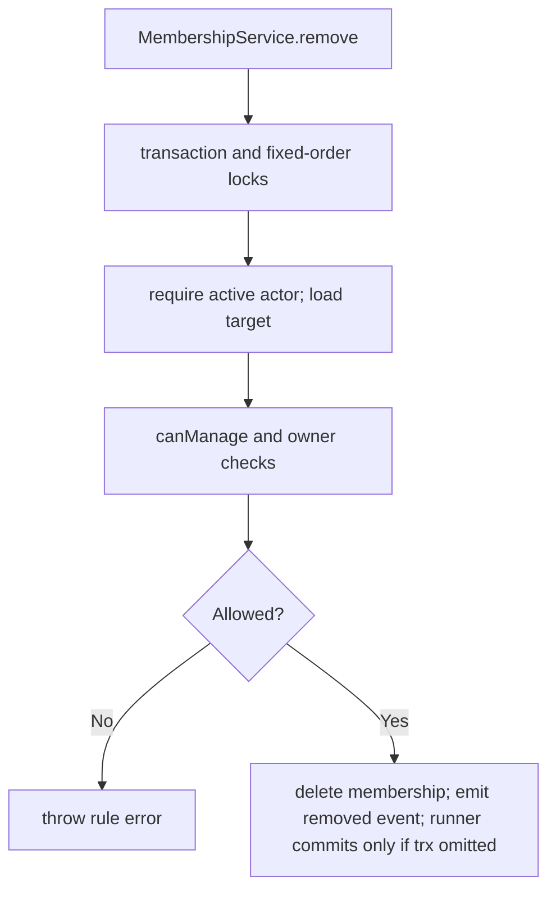

# US-ACCESS-06 — Remove a member from a scope

As an active scope manager, I want to remove a member from a scope so that a removed person no longer has membership access to this scope.

**Status:** Current
**Access:** Actor must pass `members:manage`; target cannot be self or owner and cannot outrank actor.
**Entry:** Host member route calls `memberships.remove(...)`.
**Documentation:** [memberships.md](../docs/guide/memberships.md)
**Source:** [src/memberships.ts](../src/memberships.ts)
**Coverage:** [`tests/memberships.spec.ts`](../tests/memberships.spec.ts)

## Acceptance criteria

- Removing self is refused; use `leave` for that action.
- Owner and higher-ranked targets are protected.
- Successful removal deletes the membership and emits `membership.removed` with reason `removed`; scope/application records are not deleted.

## User flow

## Code flow

Scope: package behavior; the runner commits when `input.trx` is omitted; supplied transactions remain caller-owned and may later roll back; the host owns team records, page rendering, route placement, record-level policy, and trusted operations outside the package callback.

**Code references:** [remove](../src/memberships.ts), [rules](../src/rules.ts)
