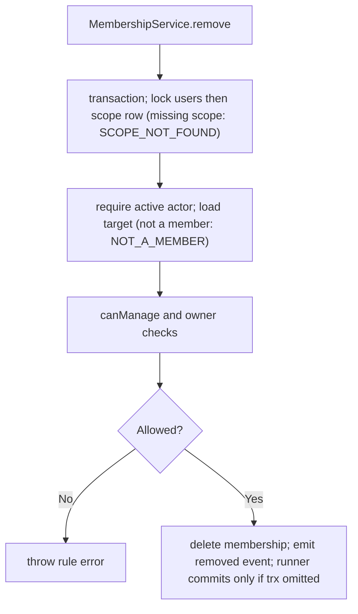

# US-ACCESS-06 — Remove a member from a scope

As an active scope manager, I want to remove a member from a scope so that a removed person no longer has membership access to this scope.

**Status:** Current
**Access:** Actor must pass `members:manage`; target cannot be self or owner and cannot outrank actor.
**Entry:** Host member route calls `memberships.remove({ actor, scopeId, userId, trx? })`.
**Documentation:** [memberships.md](../docs/guide/memberships.md)
**Source:** [src/memberships.ts](../src/memberships.ts)
**Coverage:** [`tests/memberships.spec.ts`](../tests/memberships.spec.ts)

## Acceptance criteria

| Field     | Control              | Required/default/conditions                                                                                 |
| --------- | -------------------- | ----------------------------------------------------------------------------------------------------------- |
| `actor`   | API input `{ id }`   | Required; the acting user, who must be an active member of the scope with `members:manage`.                 |
| `scopeId` | API input            | Required; normalised to the configured scope key type.                                                      |
| `userId`  | API input            | Required; the member to remove. Not a member: `E_ACCESS_CONTROL_NOT_A_MEMBER` (404), after the actor check. |
| `trx`     | Optional transaction | Omitted: the runner opens and commits one. Supplied: the caller owns commit and rollback.                   |

- Removing self is refused; use `leave` for that action.
- Owner and higher-ranked targets are protected. A target who is not a member is refused with `NOT_A_MEMBER`, and a scope row that does not exist with `E_ACCESS_CONTROL_SCOPE_NOT_FOUND` (404).
- Successful removal deletes the membership and emits `membership.removed` with reason `removed`; scope/application records are not deleted.

## User flow

```mermaid
flowchart TD
    A["Manager chooses remove member"] --> B{"Management rules allow removal?"}
    B -->|No| C["See authorization error"]
    B -->|Yes| D["Member loses membership in this scope"]
```

## Code flow

Scope: package behavior; the runner commits when `input.trx` is omitted; supplied transactions remain caller-owned and may later roll back; the host owns team records, page rendering, route placement, record-level policy, and trusted operations outside the package callback.

**Code references:** [remove](../src/memberships.ts), [rules](../src/rules.ts)
