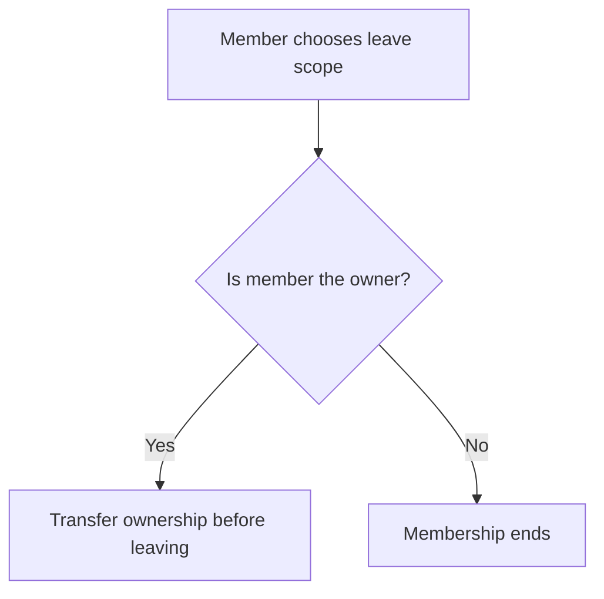
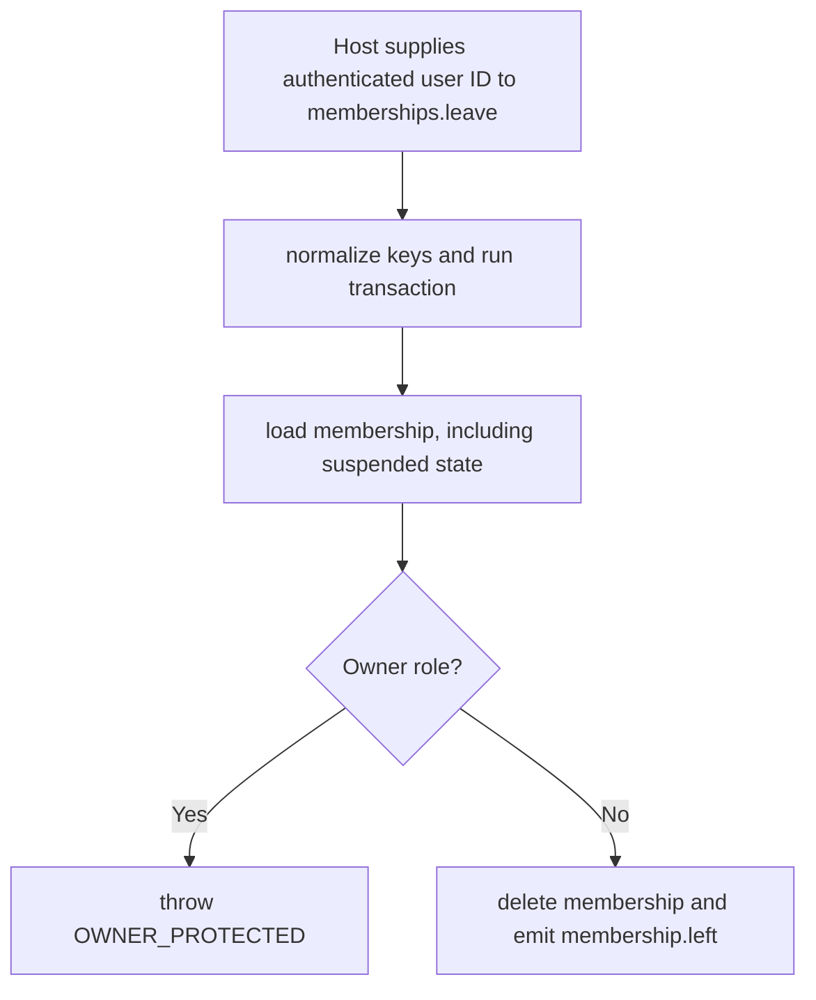

# US-ACCESS-07 — Leave a scope

As a scope member, I want to leave a scope so that members can leave without needing a manager action.

**Status:** Current
**Access:** Member can leave whether active or suspended; owner role is protected until ownership transfers.
**Entry:** Host leave route calls `memberships.leave({ scopeId, userId })` without scope middleware so suspended member can reach it.
**Documentation:** [memberships.md](../docs/guide/memberships.md)
**Source:** [src/memberships.ts](../src/memberships.ts)
**Coverage:** [`tests/memberships.spec.ts`](../tests/memberships.spec.ts)

## Acceptance criteria

- Leave is a self-action and takes no actor authorization; caller must pass authenticated user ID from host, never raw request identity.
- Suspended membership may leave.
- Owner cannot leave and receives owner-protected error. Successful leave deletes membership and emits `membership.left`.

## User flow

## Code flow

Scope: package behavior; the host owns team records, page rendering, route placement, record-level policy, and trusted operations outside the package callback.

**Code references:** [leave](../src/memberships.ts), [management rules](../docs/guide/rules.md)
