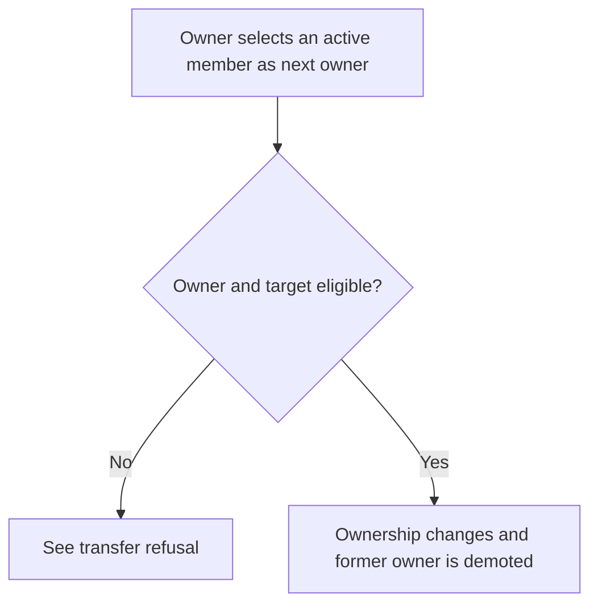
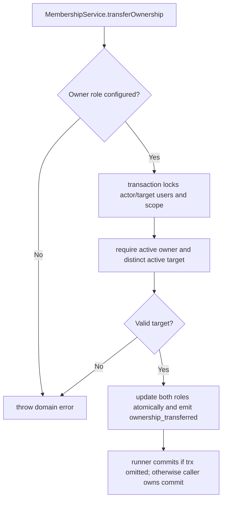

# US-ACCESS-08 — Transfer scope ownership

As an active scope owner, I want to transfer scope ownership so that a scope continues to have a clearly assigned owner.

**Status:** Current when an owner role is configured
**Access:** Only active owner can transfer to a different active member; target role and current membership are checked under locks.
**Entry:** Owner route calls `memberships.transferOwnership({ actor, scopeId, toUserId })`.
**Documentation:** [memberships.md](../docs/guide/memberships.md)
**Source:** [src/memberships.ts](../src/memberships.ts)
**Coverage:** [`tests/memberships.spec.ts`](../tests/memberships.spec.ts)

## Acceptance criteria

- Transfer is unavailable if no owner role is configured.
- Actor must be the active owner; target must be a different active member.
- The target becomes owner and prior owner is demoted to highest non-owner role in same transaction; event records transfer.

## User flow

## Code flow

Scope: package behavior; the runner commits when `input.trx` is omitted; supplied transactions remain caller-owned and may later roll back; the host owns team records, page rendering, route placement, record-level policy, and trusted operations outside the package callback.

**Code references:** [transferOwnership](../src/memberships.ts), [lock order](../src/locks.ts)
