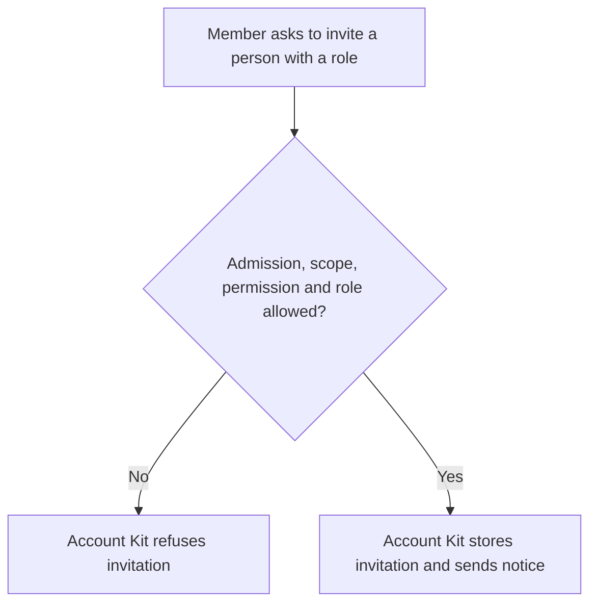
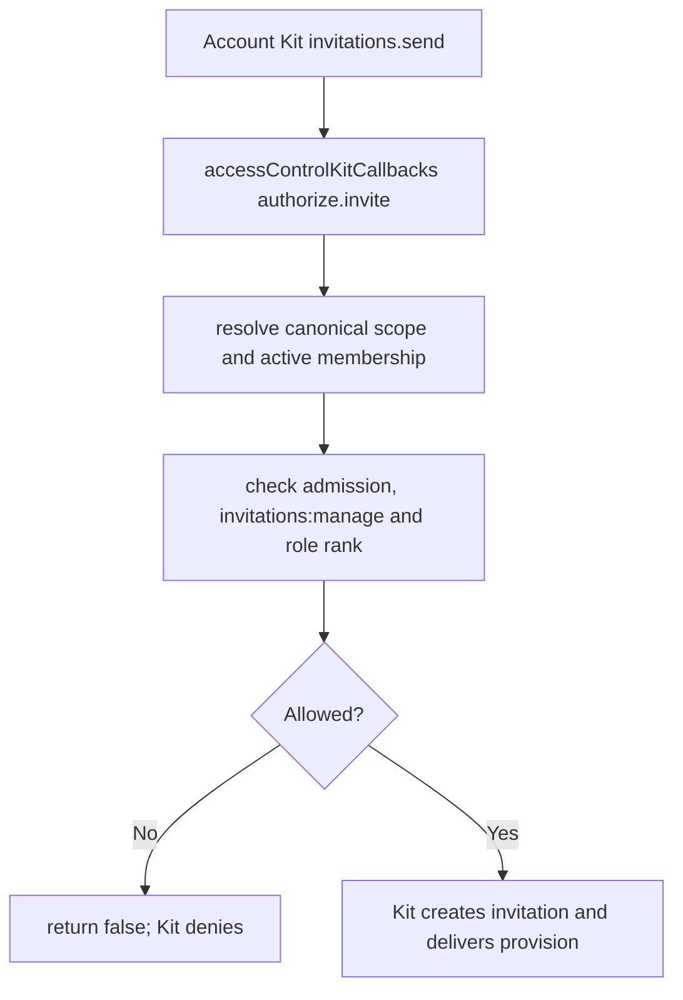

# US-ACCESS-09 — Invite a person to a scope

As an active team member allowed to invite, I want to invite a person to a scope so that a permitted teammate can bring another person into the scope.

**Status:** Current when Account Kit callbacks are wired
**Access:** Inviter is admitted if admission is active, has active canonical-scope membership and `invitations:manage`; role must be valid, non-owner, and at/below inviter rank.
**Entry:** Account Kit `invitations.send` invokes `accessControlKitCallbacks().authorize.invite`; app owns invitation entry/UI.
**Documentation:** [account-kit.md](../docs/guide/account-kit.md)
**Source:** [account_kit/main.ts](../account_kit/main.ts)
**Coverage:** [`tests/account_kit.spec.ts`](../tests/account_kit.spec.ts)

## Acceptance criteria

- Invite/manage/list authorization uses active membership and canonical configured scope.
- Optional admission check applies unless callback option sets `admission: false`.
- Role above inviter, unknown role, owner role, noncanonical scope or missing permission is denied.

## User flow

## Code flow

Scope: package behavior; the host owns team records, page rendering, route placement, record-level policy, and trusted operations outside the package callback.

**Code references:** [callback factory](../account_kit/main.ts), [Kit guide](../docs/guide/account-kit.md)
