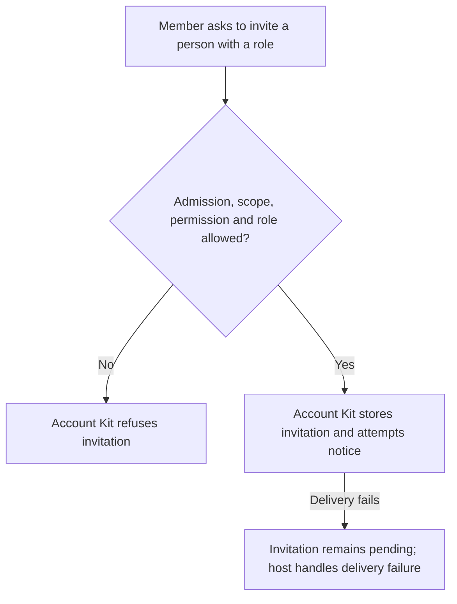
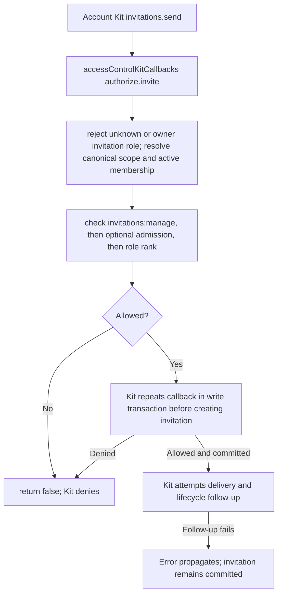

# US-ACCESS-09 — Invite a person to a scope

As an active team member allowed to invite, I want to invite a person to a scope so that a permitted teammate can bring another person into the scope.

**Status:** Current when Account Kit invitations are enabled and the relevant Access Control callback is wired
**Access:** Inviter is admitted if admission is active, has active canonical-scope membership and `invitations:manage`; role must be valid, non-owner, and at/below inviter rank.
**Entry:** Account Kit `invitations.send` invokes `accessControlKitCallbacks().authorize.invite`; app owns invitation entry/UI.
**Documentation:** [account-kit.md](../docs/guide/account-kit.md)
**Source:** [callbacks](../src/account_kit_callbacks.ts)
**Coverage:** [`tests/account_kit.spec.ts`](../tests/account_kit.spec.ts)

## Acceptance criteria

- `invitations.send({ actorId, email, role, scope })` requires an existing actor, a recipient email, a role and a canonical scope for this integration. The Access Control callback receives the actor, role and scope, plus the transaction on the recheck. Account Kit validates the email and handles recipient eligibility; its role input is a string of 1–64 characters.
- Optional admission check applies unless callback option sets `admission: false`.
- Role above inviter, unknown role, owner role, noncanonical scope or missing permission is denied.
- Account Kit checks invite permission in preflight and again in the write transaction; delivery follows commit. If delivery fails, the invitation remains pending.

## User flow

## Code flow

Scope: package behaviour; the host owns team records, page rendering, route placement, record-level policy, and trusted operations outside the package callback.

**Code references:** [callback factory](../src/account_kit_callbacks.ts), [Kit guide](../docs/guide/account-kit.md), [Account Kit sendInvitation](https://github.com/Kevinjohn/oss-adonisjs-account-kit/blob/42e6c06929baaa01f0c4810e2b9afae2e9953d7d/src/invitations.ts).
