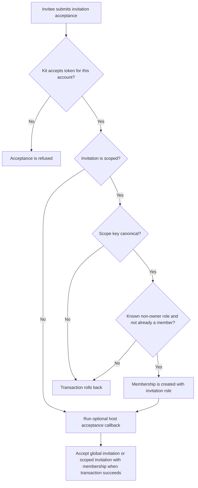
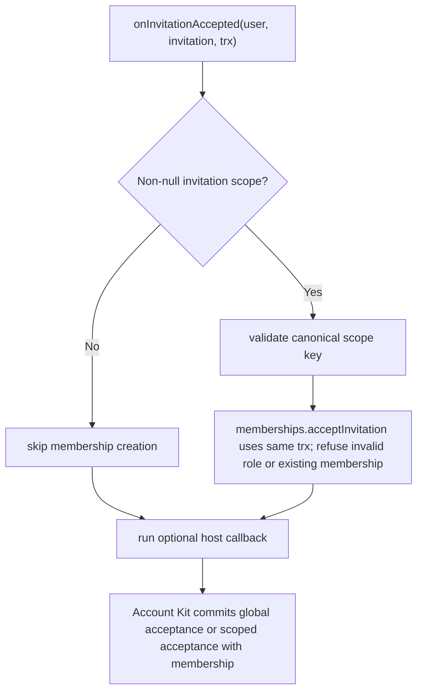

# US-ACCESS-10 — Accept a scoped invitation

As an invited account holder, I want to accept a scoped invitation so that acceptance creates the access promised by the invitation.

**Status:** Current when Account Kit acceptance callback is wired
**Access:** Invitation token/recipient validation is owned by Account Kit; scoped membership is created only for a canonical configured scope.
**Entry:** Account Kit accepts invitation then calls `onInvitationAccepted` callback.
**Documentation:** [account-kit.md](../docs/guide/account-kit.md)
**Source:** [account_kit/main.ts](../account_kit/main.ts)
**Coverage:** [`tests/account_kit.spec.ts`](../tests/account_kit.spec.ts)

## Acceptance criteria

- For a scoped invitation, scope must use canonical configured key spelling; invalid scope is refused.
- For scoped invitations, trusted `acceptInvitation` refuses unknown/owner roles and existing membership, otherwise creates membership inside the Account Kit transaction. The optional host callback runs for both scoped and global invitations in that transaction.
- Global invitation (`scope: null`) does not create team membership.

## User flow

## Code flow

Scope: package behavior; the host owns team records, page rendering, route placement, record-level policy, and trusted operations outside the package callback.

**Code references:** [acceptance callback](../account_kit/main.ts), [trusted method](../src/memberships.ts)
