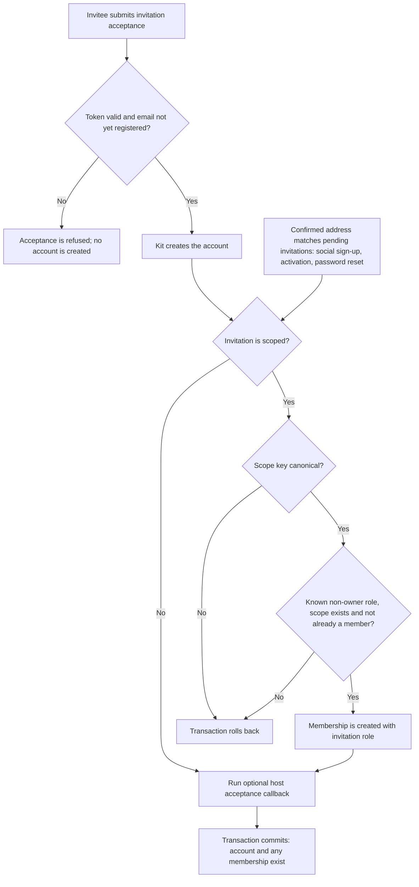
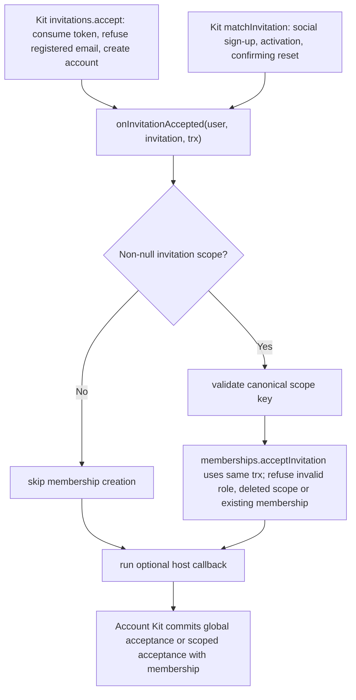

# US-ACCESS-10 — Accept a scoped invitation

As an invited account holder, I want to accept a scoped invitation so that acceptance creates the access promised by the invitation.

**Status:** Current when Account Kit acceptance callback is wired
**Access:** Invitation token/recipient validation is owned by Account Kit; acceptance creates the account and is refused for an already registered email. Scoped membership is created only for a canonical configured scope.
**Entry:** Account Kit `invitations.accept` consumes the token, creates the account, then calls the `onInvitationAccepted` callback. The callback also runs for each pending invitation matched to a newly confirmed address: social sign-up with a provider-verified email, account activation, and a password reset that confirms a never-confirmed account.
**Documentation:** [account-kit.md](../docs/guide/account-kit.md)
**Source:** [account_kit/main.ts](../account_kit/main.ts)
**Coverage:** [`tests/account_kit.spec.ts`](../tests/account_kit.spec.ts)

## Acceptance criteria

- Accepting by token creates the account; a token for an already registered email is refused and no account is created. Matched invitations (social sign-up, activation, confirming password reset) run the same callback for an account that already exists.
- For a scoped invitation, scope must use canonical configured key spelling; invalid scope is refused.
- For scoped invitations, trusted `acceptInvitation` refuses unknown/owner roles, a deleted scope (`E_ACCESS_CONTROL_SCOPE_NOT_FOUND`) and existing membership, otherwise creates membership inside the Account Kit transaction. Any refusal rolls back the whole acceptance, so no account is left behind. The optional host callback runs for both scoped and global invitations in that transaction.
- Global invitation (`scope: null`) does not create team membership.

## User flow

## Code flow

Scope: package behavior, entered from Account Kit acceptance and matched-invitation paths; the host owns team records, page rendering, route placement, record-level policy, and trusted operations outside the package callback.

**Code references:** [acceptance callback](../account_kit/main.ts), [trusted method](../src/memberships.ts), [scope lock](../src/locks.ts), Account Kit `node_modules/@kevinjohn/adonisjs-account-kit/build/account_kit-DJQDBFqq.js:1667-1678` (accept) and `:67-80` (matchInvitation)
