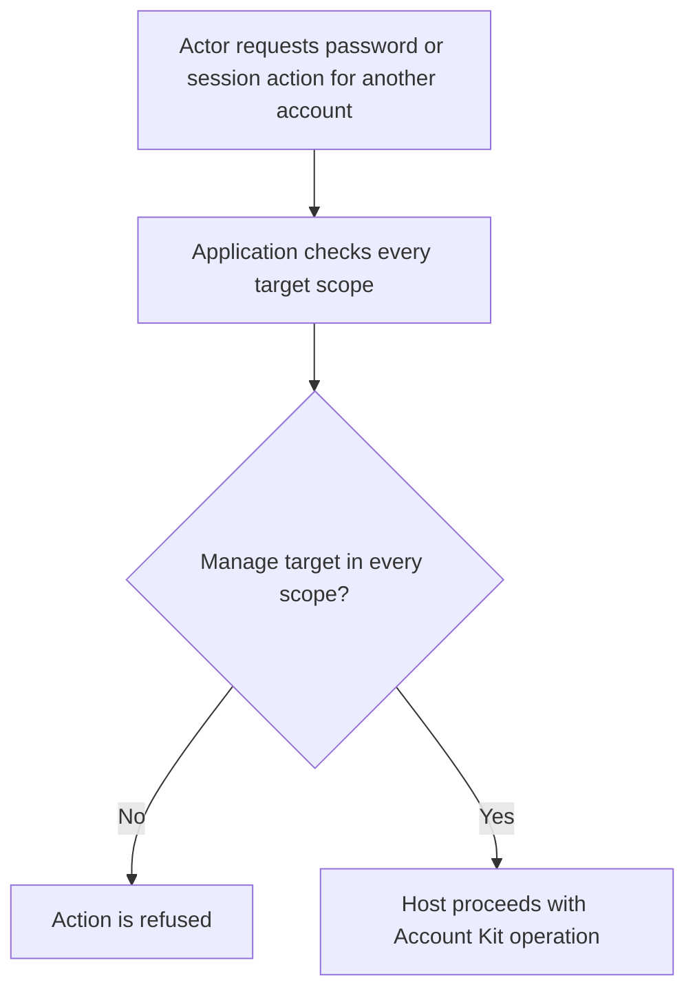
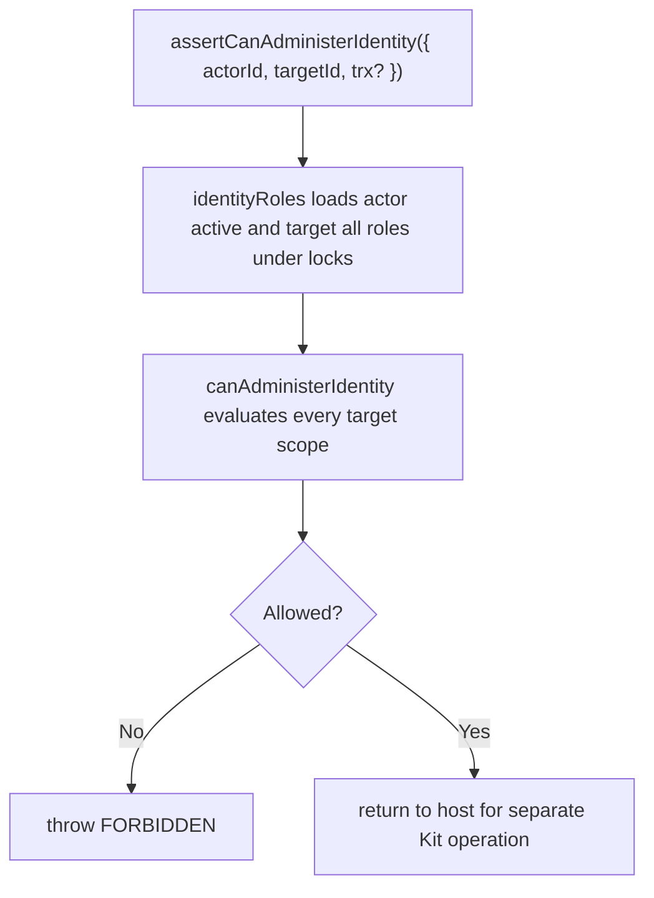

# US-ACCESS-11 — Apply cross-scope identity administration rules

As an application administrator, I want to apply cross-scope identity administration rules so that a global account action respects every scope’s role rules.

**Status:** Current when host checks before protected account operation
**Access:** For another account, actor must be able to manage target in every target scope; target with no memberships cannot be administered. Self-administration is allowed only when target has memberships.
**Entry:** Host invokes `memberships.assertCanAdministerIdentity` immediately before an Account Kit identity-wide operation.
**Documentation:** [rules.md](../docs/guide/rules.md)
**Source:** [src/memberships.ts](../src/memberships.ts)
**Coverage:** [`tests/memberships_trusted.spec.ts`](../tests/memberships_trusted.spec.ts)

## Acceptance criteria

- Actor map contains active memberships; target map includes suspended memberships and is loaded under locks.
- A target with no memberships cannot be administered. Otherwise any target scope where actor is absent, too low-ranked, or target owns scope denies the operation; self-administration is allowed only when the target has membership data.
- Assertion covers authorization at check time only; host operation runs separately and is not made atomic with that check.

## User flow

## Code flow

Scope: package behavior; the host owns team records, page rendering, route placement, record-level policy, and trusted operations outside the package callback.

**Code references:** [identity methods](../src/memberships.ts), [predicate](../src/rules.ts), [rules guide](../docs/guide/rules.md)
