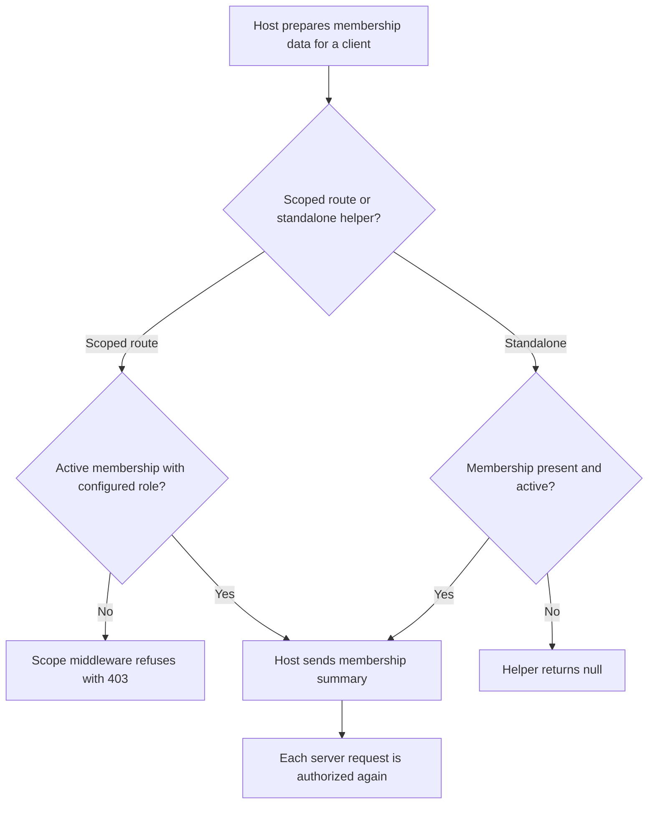
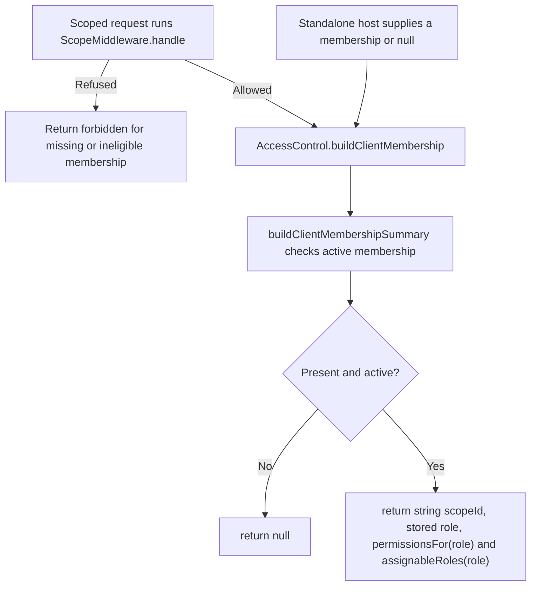

# US-ACCESS-12 — Send effective membership permissions to a client

As a client application using team-aware controls, I want to send effective membership permissions to a client so that the client can reflect the effective account’s current access.

**Status:** Current
**Access:** Host derives the client membership summary from effective account membership; the summary is presentational and does not authorize requests.
**Entry:** Host controller calls `accessControl.buildClientMembership(membership)`.
**Documentation:** [client.md](../docs/guide/client.md)
**Source:** [src/client_membership.ts](../src/client_membership.ts)
**Coverage:** [`tests/payload.spec.ts`](../tests/payload.spec.ts)

## Acceptance criteria

- Active membership returns the scope ID as a string, the stored role, permissions and assignable roles. An unknown active role is retained with both lists empty.
- The standalone helper returns `null` for missing or suspended membership. A scoped HTTP route
  refuses that request with 403 before its controller reaches the helper. It also refuses an unknown role.
- Server still checks each route with scope middleware/Bouncer and application record policy.

## User flow

## Code flow

Scope: package behaviour; the host owns team records, page rendering, route placement, record-level policy, and trusted operations outside the package callback.

**Code references:** [scope route](US-ACCESS-02-enter-scoped-route.md), [instance methods](../src/define.ts), [client membership summary](../src/client_membership.ts), [client guide](../docs/guide/client.md)
