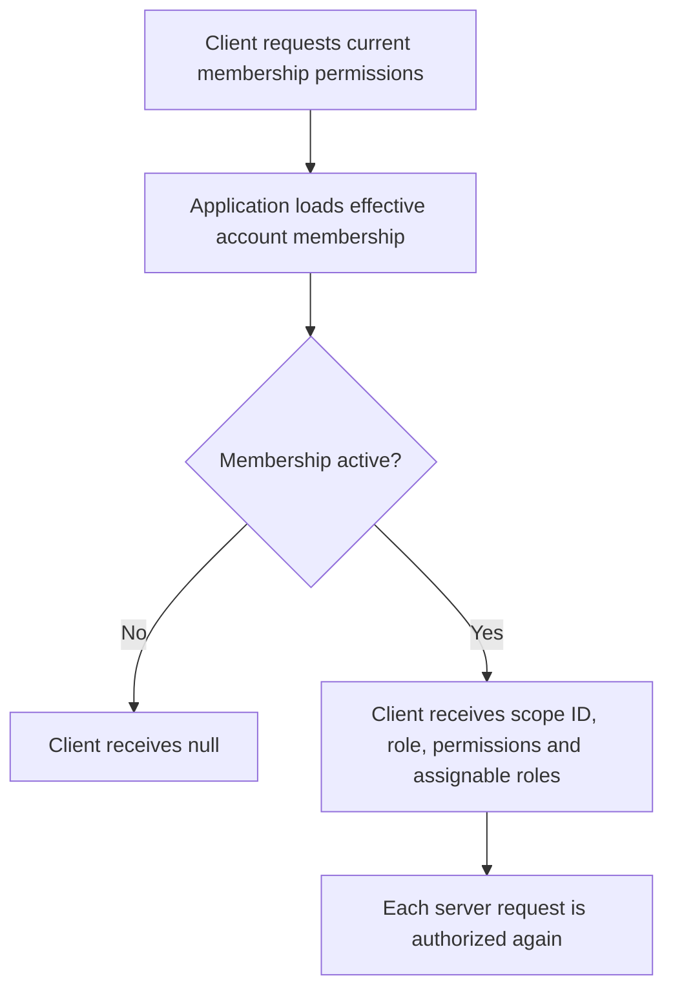
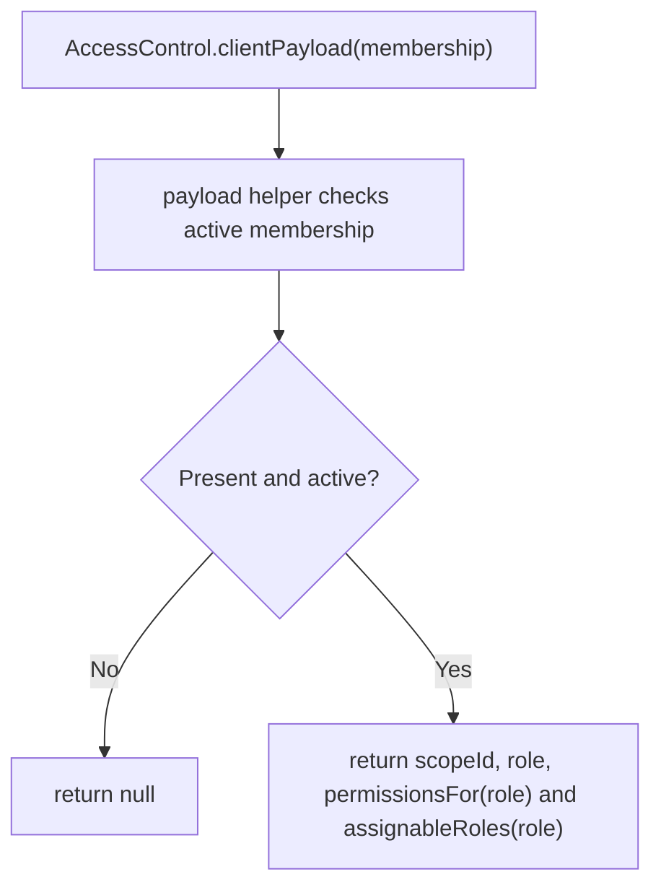

# US-ACCESS-12 — Send effective membership permissions to a client

As a client application using team-aware controls, I want to send effective membership permissions to a client so that the client can reflect the effective account’s current access.

**Status:** Current
**Access:** Host derives payload from effective account membership; payload is presentational and does not authorize requests.
**Entry:** Host controller calls `accessControl.clientPayload(membership)`.
**Documentation:** [client.md](../docs/guide/client.md)
**Source:** [src/payload.ts](../src/payload.ts)
**Coverage:** [`tests/payload.spec.ts`](../tests/payload.spec.ts)

## Acceptance criteria

- Active membership returns `scopeId`, `role`, `permissions`, and `assignableRoles`.
- Missing or suspended membership returns `null`.
- Server still checks each route with scope middleware/Bouncer and application record policy.

## User flow

## Code flow

Scope: package behavior; the host owns team records, page rendering, route placement, record-level policy, and trusted operations outside the package callback.

**Code references:** [payload](../src/payload.ts), [client guide](../docs/guide/client.md)
