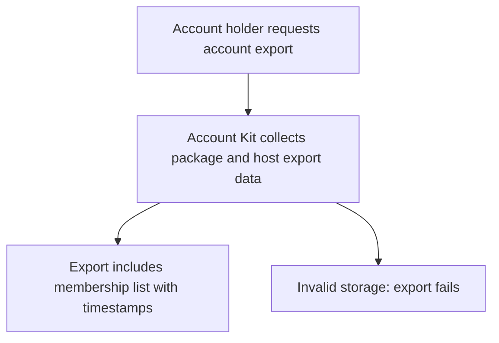
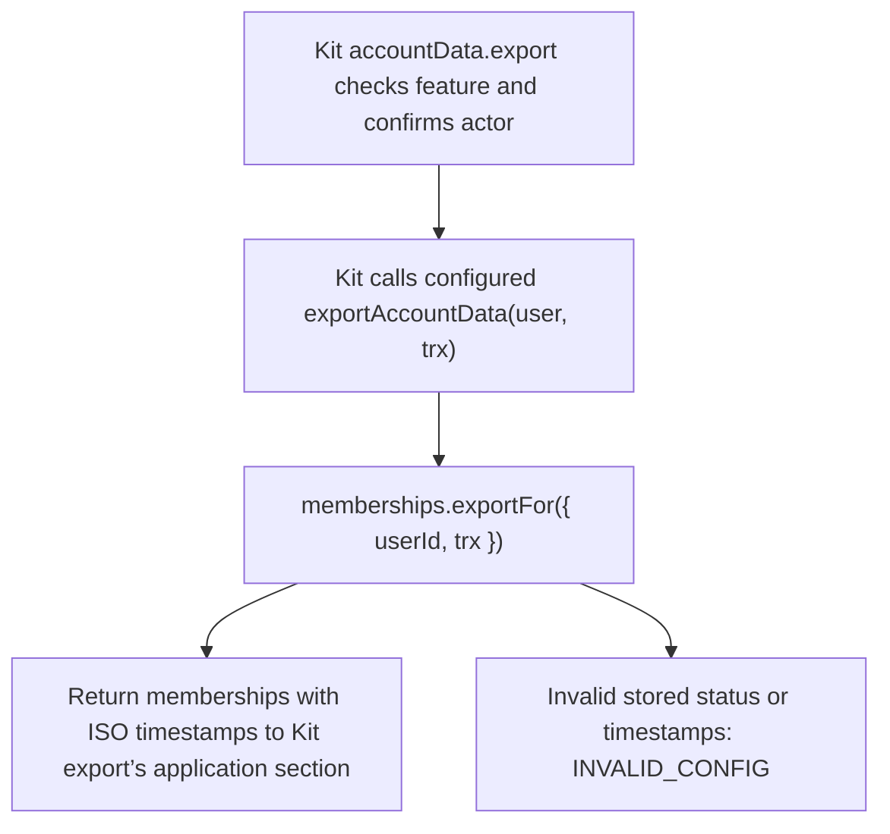

# US-ACCESS-13 — Export membership data with account records

As an application integrator, I want to export membership data with account records so that people can receive a complete account export.

**Status:** Current when Access Control callbacks are included in Account Kit config
**Access:** Account Kit data export must be enabled and the account holder must satisfy its proof check. Access Control callback adds the user’s membership rows using the supplied Kit transaction.
**Entry:** Host wires `exportAccountData` from `accessControlKitCallbacks()` into Account Kit and calls `accountData.export({ actorId, currentPassword?, recentProof? })`.
**Documentation:** [account-kit.md](../docs/guide/account-kit.md)
**Source:** [src/account_kit/main.ts](../src/account_kit/main.ts)
**Coverage:** [`tests/account_kit.spec.ts`](../tests/account_kit.spec.ts)

## Acceptance criteria

- Exporting a stored row with an invalid status or a missing or unreadable required timestamp raises `E_ACCESS_CONTROL_INVALID_CONFIG` (500). The host receives the failure instead of a partially sanitised export. See [storage and export tests](../tests/membership_storage.spec.ts).

- Account export includes `application.memberships` with `scopeId`, `role`, `status`, `createdAt` and `updatedAt`. Both timestamps are ISO strings in UTC.
- Export is a plain read through the supplied transaction; host owns the surrounding export route, proof and response.

## User flow

## Code flow

Scope: package behaviour; the host owns team records, page rendering, route placement, record-level policy, and trusted operations outside the package callback.

**Code references:** [callbacks](../src/account_kit/main.ts), [lifecycle methods](../src/memberships.ts), [Account Kit export](https://github.com/Kevinjohn/oss-adonisjs-account-kit/blob/d01b742c5416b747b300402c1669f5aaf6bba290/src/account_export.ts).
