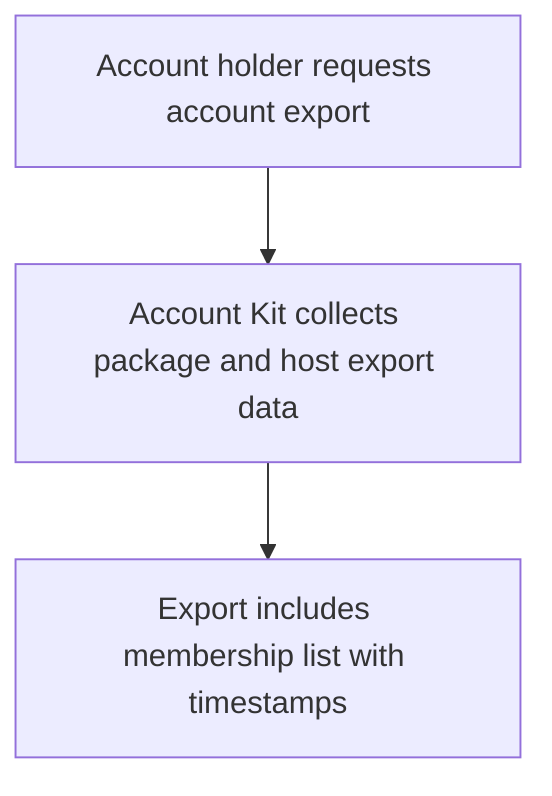
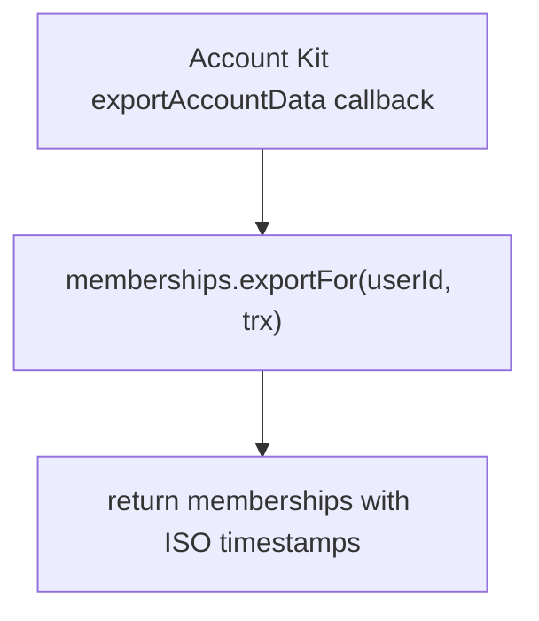

# US-ACCESS-13 — Export membership data with account records

As an application integrator, I want to export membership data with account records so that people can receive a complete account export.

**Status:** Current when Access Control callbacks are included in Account Kit config
**Access:** Account Kit owns export; Access Control callback adds the user’s membership rows using the supplied Kit transaction.
**Entry:** Host spreads `accessControlKitCallbacks()` into `config/account_kit.ts`.
**Documentation:** [account-kit.md](../docs/guide/account-kit.md)
**Source:** [account_kit/main.ts](../account_kit/main.ts)
**Coverage:** [`tests/account_kit.spec.ts`](../tests/account_kit.spec.ts)

## Acceptance criteria

- Account export adds the user’s memberships with ISO timestamps.
- Export is a plain read through the supplied transaction; host owns the surrounding export route, proof and response.

## User flow

## Code flow

Scope: package behavior; the host owns team records, page rendering, route placement, record-level policy, and trusted operations outside the package callback.

**Code references:** [callbacks](../account_kit/main.ts), [lifecycle methods](../src/memberships.ts)
