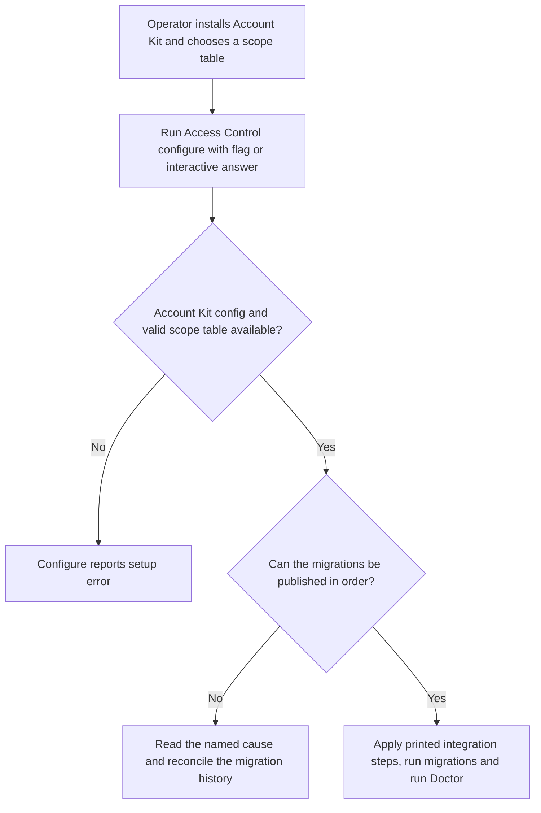
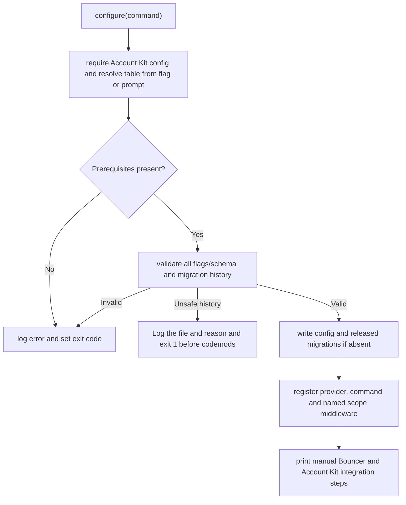

# US-ACCESS-14 — Configure Access Control

As an application operator, I want to configure Access Control so that the application can use the package with its actual scope schema.

**Status:** Operator
**Access:** Operator configures roles, schema and provider after Account Kit is installed.
**Entry:** After Account Kit has created `account_kit.ts` in the app config directory, run `node ace configure @kevinjohn/adonisjs-access-control --scope-table=<table>`.
**Documentation:** [setup.md](../docs/guide/setup.md)
**Source:** [configure.ts](../configure.ts)
**Coverage:** [`tests/configure.spec.ts`](../tests/configure.spec.ts)

## Acceptance criteria

- In an interactive terminal, omitting `--scope-table` prompts “Which table holds the scope rows?” Unattended runs must supply it. Optional flags are `--scope-id-type` (`integer`, default), `--users-table` (`users`), `--user-id-type` (`integer`) and `--memberships-table` (`memberships`). Key types are `integer`, `string` or `uuid`; table names must be plain SQL identifiers.
- Configure refuses when Account Kit config is missing. Invalid flag values and unsafe migration histories fail before codemods write files. `--migration-path` selects the destination, defaulting to the app migrations path. New migrations follow existing parent migrations in filename order. A rerun preserves existing files and publishes only missing released successors beside the last installed Access Control migration, including nested paths. Unsafe histories name the file and reason. Keep applied filenames and reconcile the order or select a suitable migration directory before rerunning.
- Configure writes config and released migration(s), registers provider, doctor command and named `scope` middleware, and prints the Bouncer and Account Kit edits using the host’s config and middleware paths. Apply the edits, then run migrations and Doctor.

## User flow

## Code flow

Scope: configure publishes package files and integration steps; the operator applies the host-owned code printed by the command.

**Code references:** [configureWith and manualSteps](../configure.ts), [planMigrations](../src/migration_order.ts), [setup guide](../docs/guide/setup.md)
