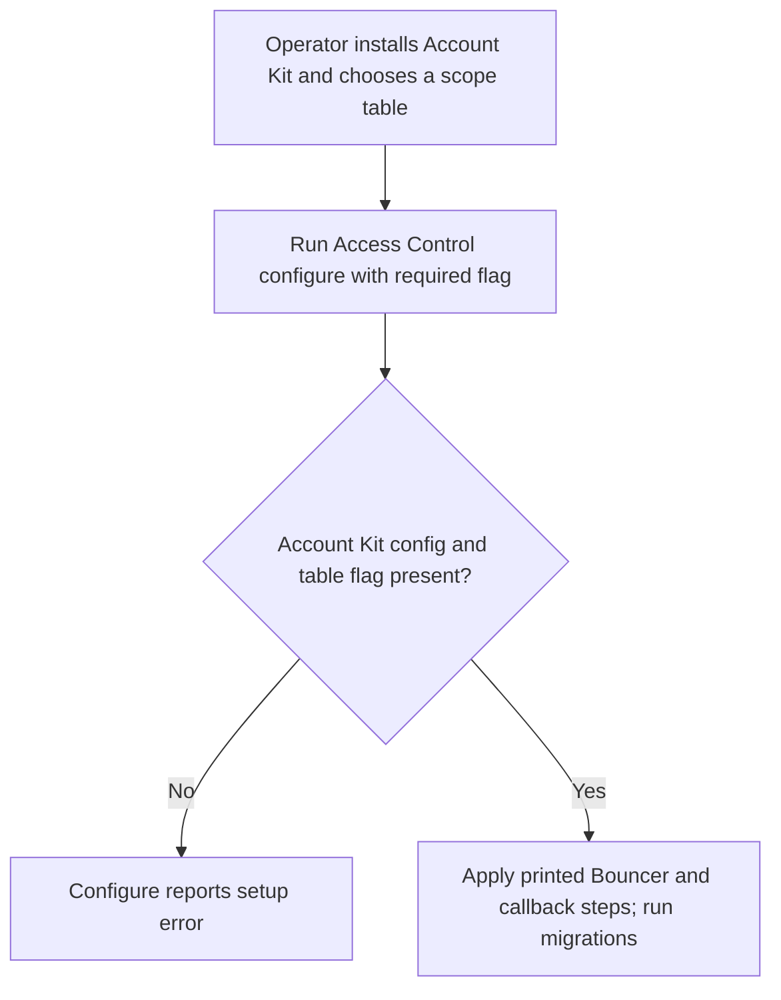
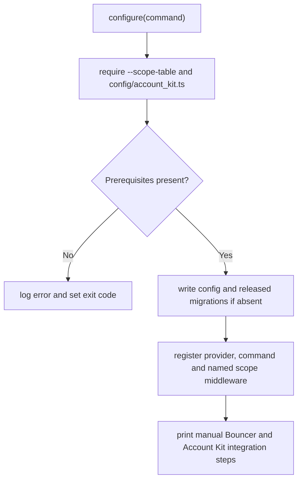

# US-ACCESS-14 — Configure Access Control

As an application operator, I want to configure Access Control so that the application can use the package with its actual scope schema.

**Status:** Operator
**Access:** Operator configures roles, schema and provider after Account Kit is installed.
**Entry:** After Account Kit has created `config/account_kit.ts`, run `node ace configure @kevinjohn/adonisjs-access-control --scope-table=<table>`.
**Documentation:** [setup.md](../docs/guide/setup.md)
**Source:** [configure.ts](../configure.ts)
**Coverage:** [`tests/configure.spec.ts`](../tests/configure.spec.ts)

## Acceptance criteria

- `--scope-table` is required. Optional flags are `--scope-id-type` (`integer`, default), `--users-table` (`users`), `--user-id-type` (`integer`) and `--memberships-table` (`memberships`). Key types are `integer`, `string` or `uuid`; table names must be plain SQL identifiers.
- Configure refuses if Account Kit config or `--scope-table` is absent; existing files are skipped, not overwritten.
- Configure writes config and released migration(s), registers provider, doctor command and named `scope` middleware, and prints the Bouncer and Account Kit edits for the operator to apply. Run migrations after applying those changes.

## User flow

## Code flow

Scope: configure publishes package files and integration steps; the operator applies the host-owned code printed by the command.

**Code references:** [configure](../configure.ts), [setup guide](../docs/guide/setup.md)
