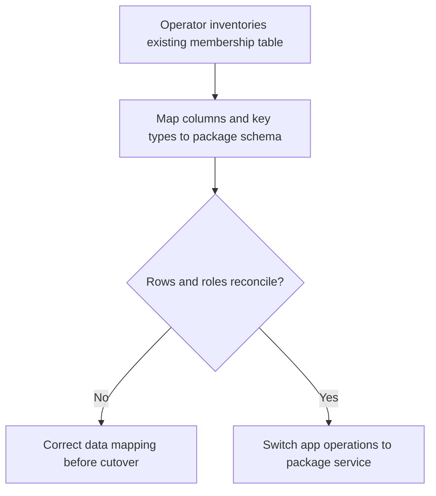
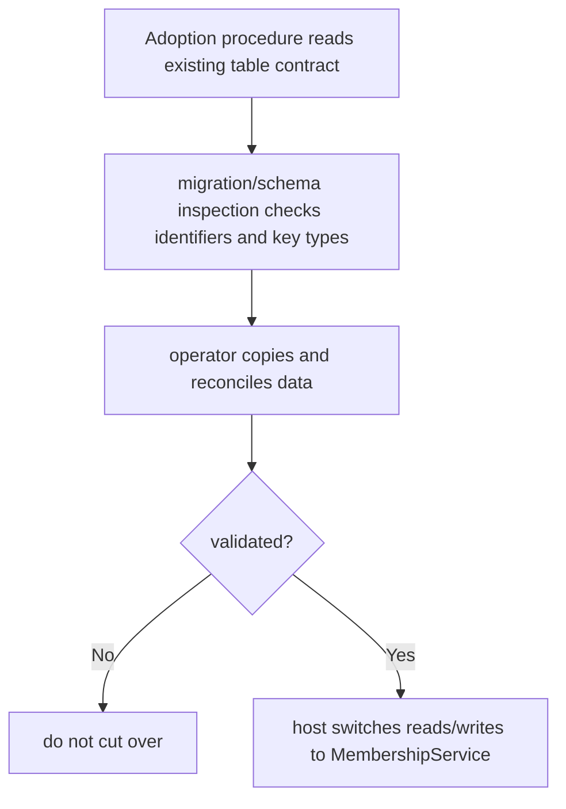

# US-ACCESS-15 — Adopt existing membership data

As an application operator, I want to adopt existing membership data so that access data is reconciled before the application changes over.

**Status:** Operator
**Access:** Migration owner has access to application membership table and follows the documented staged adoption procedure.
**Entry:** Follow adoption guide to map, copy and reconcile existing membership rows before switching services.
**Documentation:** [adopting.md](../docs/guide/adopting.md)
**Source:** [src/migration_schema.ts](../src/migration_schema.ts)
**Coverage:** [`tests/migration_stubs.spec.ts`](../tests/migration_stubs.spec.ts)

## Acceptance criteria

- Existing table shape and key types are compared with configured membership schema before cutover.
- The application moves data and validates counts/keys/roles before switching reads and writes to package service.
- The package does not silently infer or migrate arbitrary app-owned team/domain rules.

## User flow

## Code flow

Scope: package behavior; the host owns team records, page rendering, route placement, record-level policy, and trusted operations outside the package callback.

**Code references:** [adoption guide](../docs/guide/adopting.md), [schema contract](../src/migration_schema.ts)
