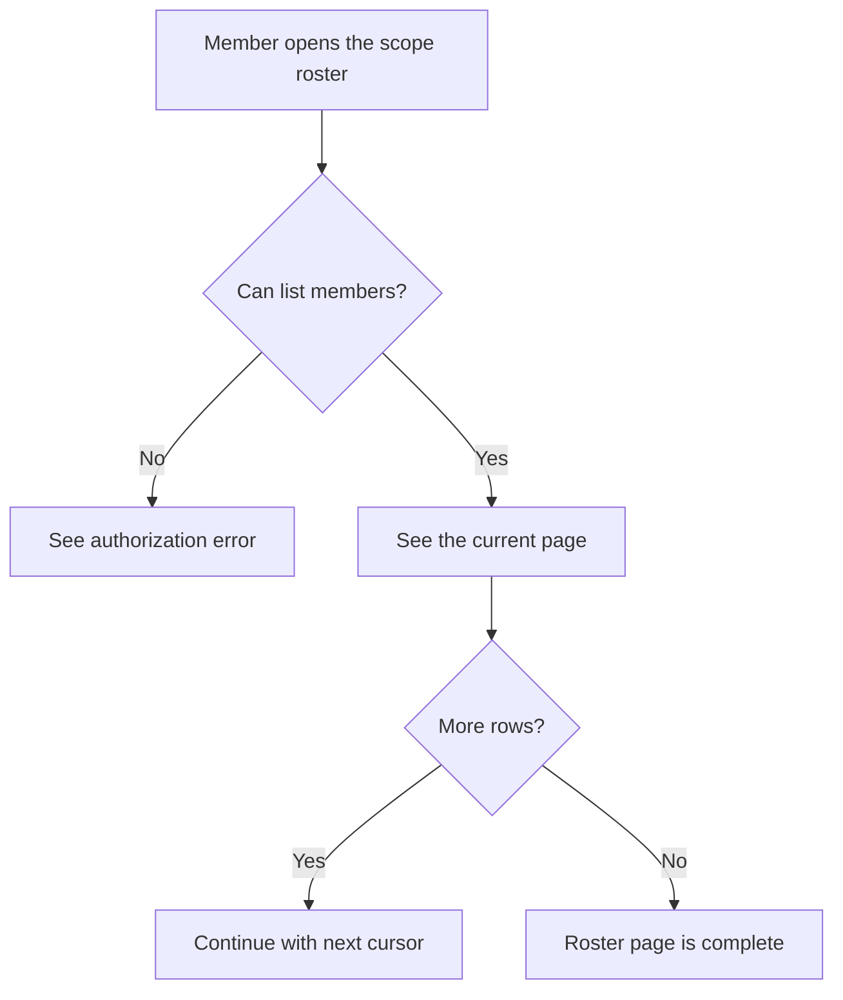
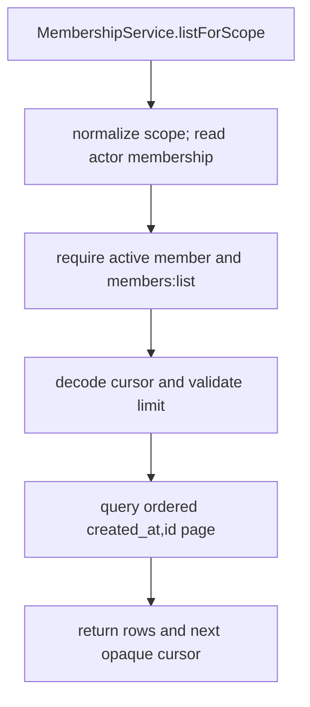

# US-ACCESS-16 — Review a paginated scope member list

As a scope member, I want to review a paginated scope member list so that scope membership stays clear and controlled.

**Status:** Current
**Access:** Actor must have an active membership and a role satisfying `members:list`; this permission need not imply `members:manage`.
**Entry:** Route loads a page through `memberships.listForScope({ actor, scopeId, cursor, limit })`.
**Documentation:** [memberships.md](../docs/guide/memberships.md)
**Source:** [src/memberships.ts](../src/memberships.ts)
**Coverage:** [`tests/memberships.spec.ts`](../tests/memberships.spec.ts)

## Acceptance criteria

- Results are ordered by `created_at` then `id` using an opaque cursor.
- `limit` defaults to 25 and must be from 1 to 100.
- Missing/suspended actor or missing `members:list` permission is refused; listing is not restricted to members with `members:manage`.

## User flow

## Code flow

Scope: package transaction and host callback boundary; the host owns screens, response mapping and application-specific policy.

**Code references:** [listForScope](../src/memberships.ts), [pagination](../src/pagination.ts)
