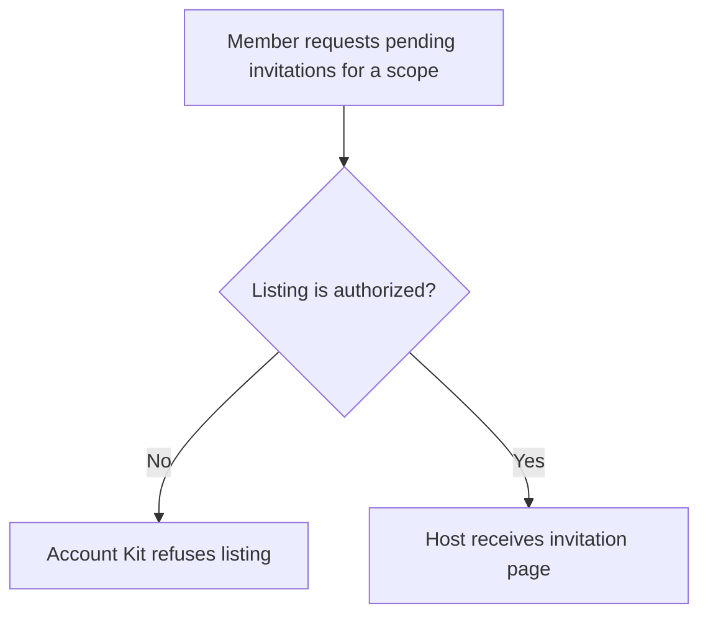
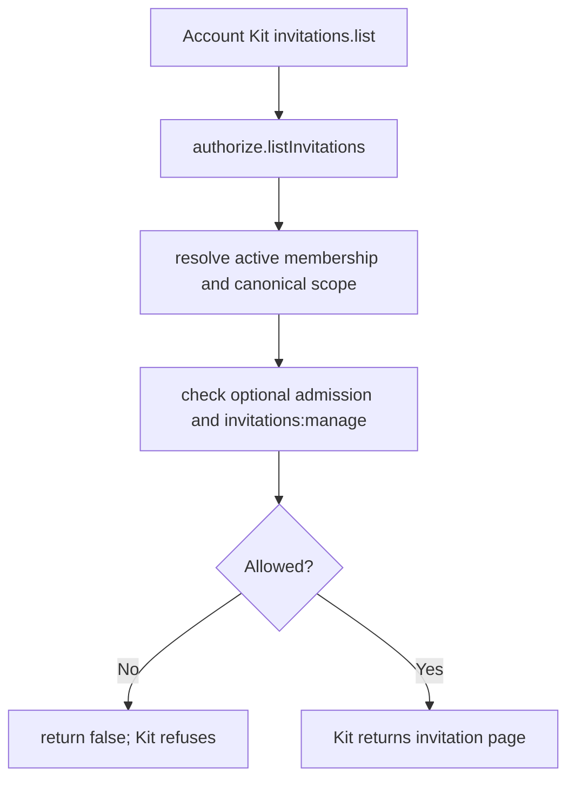

# US-ACCESS-17 — List pending invitations

As an active member allowed to manage invitations, I want to list pending invitations so that I can review invitations for my scope.

**Status:** Current when Account Kit callback integration is configured
**Access:** Actor must be admitted when admission checks are on, active in the canonical current scope, and have `invitations:manage`.
**Entry:** Account Kit `invitations.list({ actorId, scope, limit?, cursor? })` invokes `accessControlKitCallbacks().authorize.listInvitations`.
**Documentation:** [account-kit.md](../docs/guide/account-kit.md)
**Source:** [account_kit/main.ts](../account_kit/main.ts)
**Coverage:** [`tests/account_kit.spec.ts`](../tests/account_kit.spec.ts)

## Acceptance criteria

- Listing requires an active membership in the canonical current scope with `invitations:manage`; admission is also checked when enabled.
- A scope is required for authorization: a list call without `scope` reaches the callback with an empty context and is refused.
- The callback returns authorization only; Account Kit performs listing and the host owns page rendering.

## User flow

## Code flow

Scope: the package callback authorizes; Account Kit performs the invitation query and response.

**Code references:** [callbacks](../account_kit/main.ts), [membership rules](../docs/guide/rules.md)
