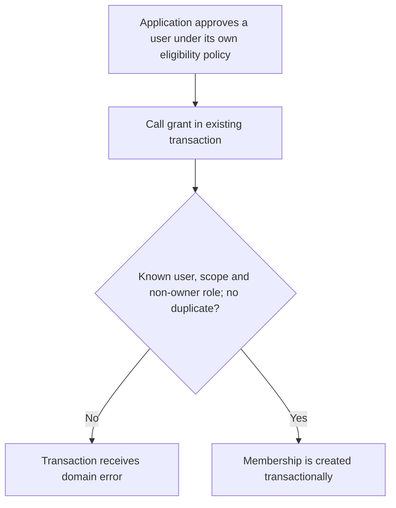
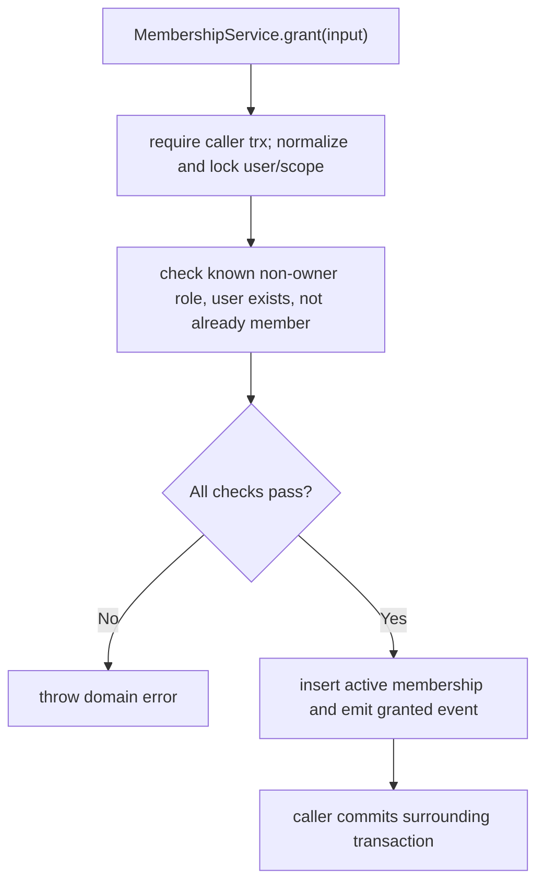

# US-ACCESS-18 — Grant a membership after application approval

As an application lifecycle integration, I want to grant a membership after application approval so that application-specific eligibility can create scope access.

**Status:** Current
**Access:** Trusted callback only; host must authorize the change and keep provided Kit/application transaction. Never expose actorless methods to raw request input.
**Entry:** Application admission/eligibility callback calls `memberships.grant` in the application transaction.
**Documentation:** [memberships.md](../docs/guide/memberships.md)
**Source:** [src/memberships.ts](../src/memberships.ts)
**Coverage:** [`tests/memberships_trusted.spec.ts`](../tests/memberships_trusted.spec.ts)

## Acceptance criteria

- `grant` creates a non-owner membership only after the application has independently authorized it; it requires the Kit runner transaction and refuses a missing user, missing scope or duplicate membership.
- The method has no actor authorization of its own. Host keeps it behind its admission/eligibility policy and passes the existing Kit transaction.

## User flow

## Code flow

Scope: trusted membership creation; application eligibility and transaction commit belong to the host.

**Code references:** [trusted methods](../src/memberships.ts), [transaction guidance](../docs/guide/memberships.md)
