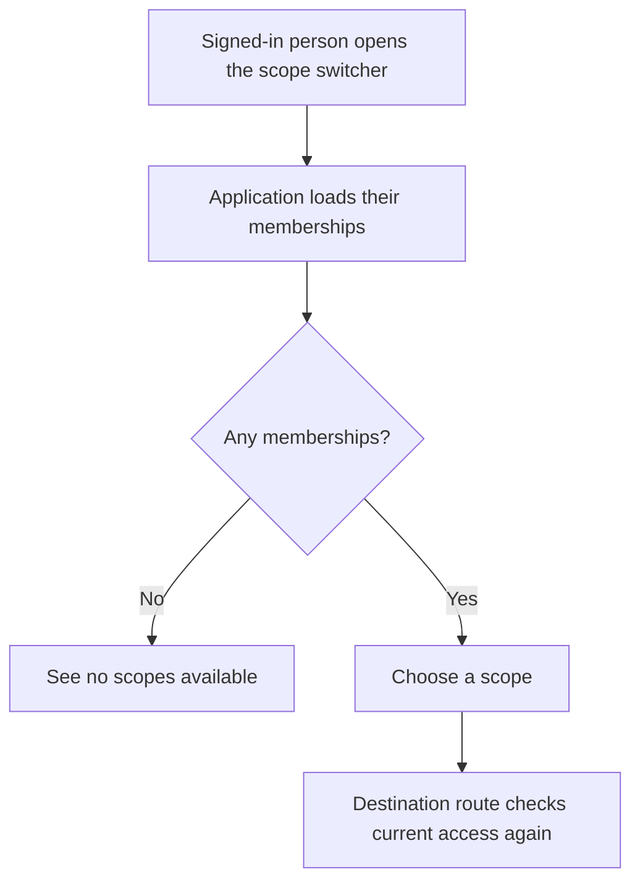
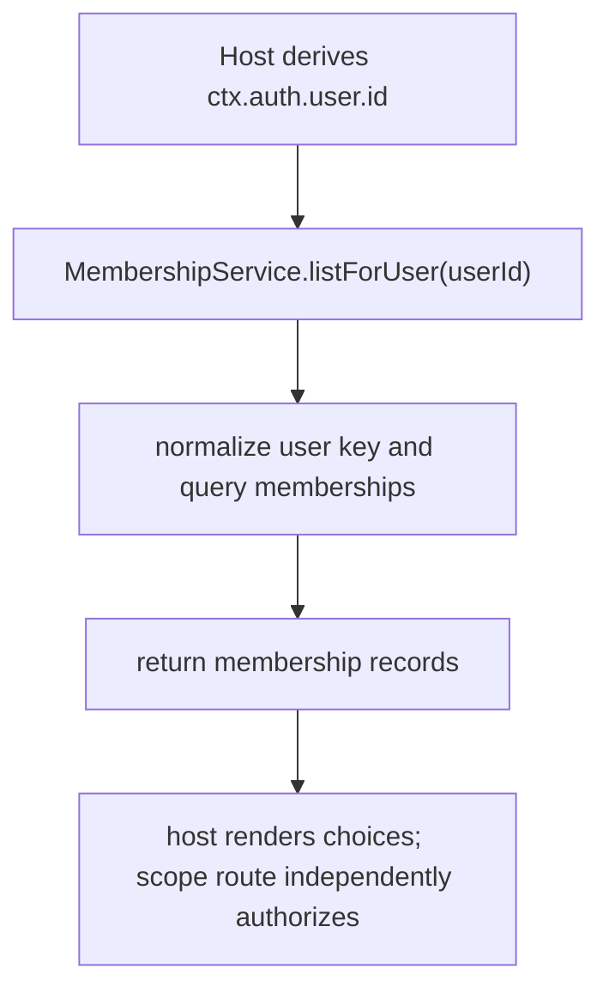

# US-ACCESS-19 — View scopes I belong to

As a signed-in account holder, I want to see my memberships so that I can choose which scope to enter.

**Status:** Current as a service read; the application supplies the route and page.
**Access:** Host must derive `userId` from the authenticated effective account. `MembershipService.listForUser(userId, trx?)` accepts a user ID and does not itself authorize that it belongs to the caller.
**Entry:** Host account/team switcher calls `memberships.listForUser(userId)`.
**Documentation:** [Membership operations](../docs/guide/memberships.md)
**Source:** [`MembershipService.listForUser`](../src/memberships.ts)
**Coverage:** [`tests/memberships.spec.ts`](../tests/memberships.spec.ts)

## Acceptance criteria

- The returned memberships include scope ID, role, status and timestamps for that user.
- Host uses the effective authenticated account ID, not a user ID supplied by an untrusted client.
- This list read does not authorize scope access; the destination route still runs account middleware, scope middleware and Bouncer.

## User flow

## Code flow

Scope: service read only; host owns identity binding, route and presentation.

**Code references:** [listForUser](../src/memberships.ts), [scope middleware](../middleware/main.ts)
