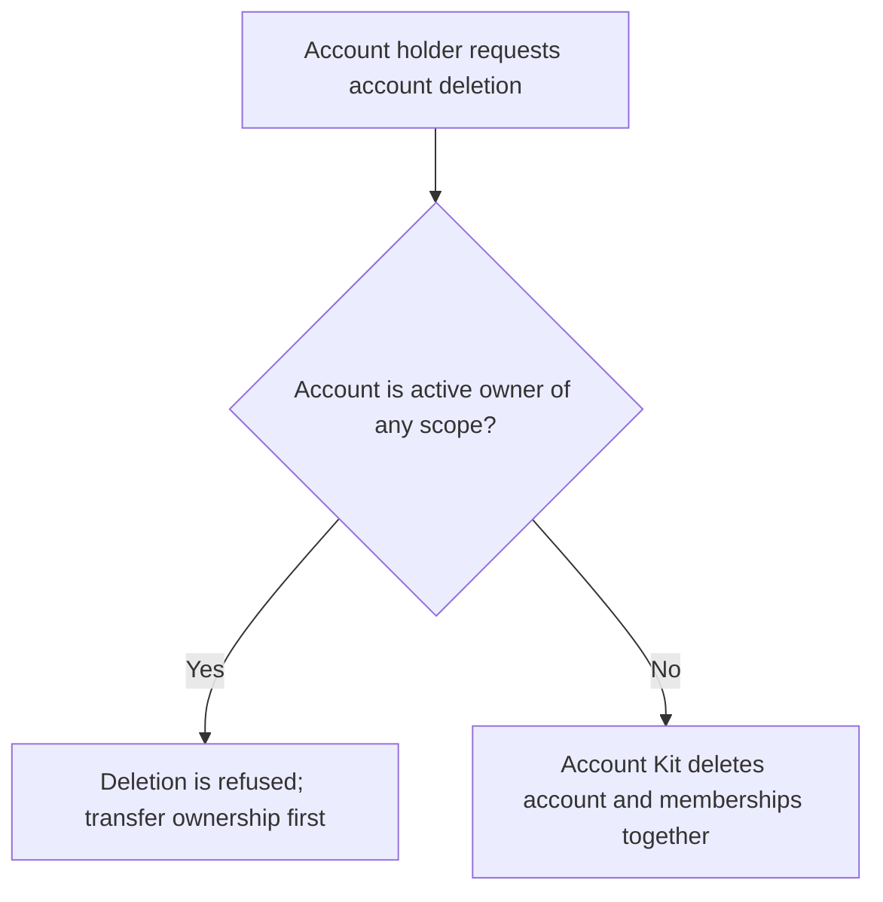
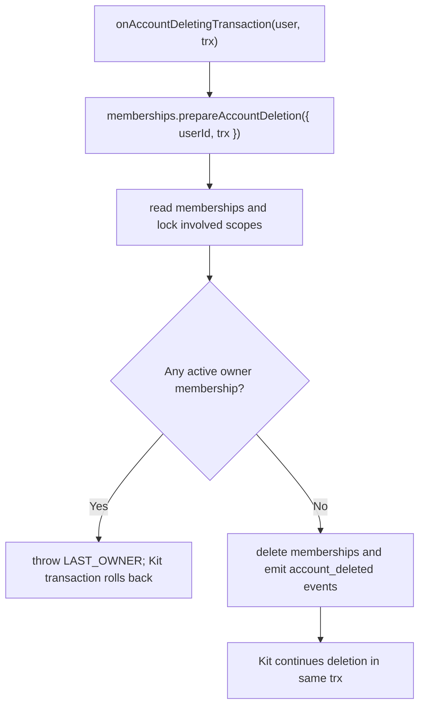

# US-ACCESS-20 — Protect scope ownership during account deletion

As an application integrator, I want to protect scope ownership during account deletion so that account deletion removes its memberships without leaving an ownerless scope.

**Status:** Current when Account Kit lifecycle callbacks are wired
**Access:** Account Kit owns deletion; Access Control callback refuses deletion while account has active owner membership.
**Entry:** Account Kit `onAccountDeletingTransaction` callback calls `memberships.prepareAccountDeletion` in Kit transaction.
**Documentation:** [account-kit.md](../docs/guide/account-kit.md)
**Source:** [account_kit/main.ts](../account_kit/main.ts)
**Coverage:** [`tests/memberships_trusted.spec.ts`](../tests/memberships_trusted.spec.ts)

## Acceptance criteria

- Membership rows are removed in the Kit deletion transaction when no active owner rule blocks it.
- If account owns any scope as an active member, deletion raises `E_ACCESS_CONTROL_LAST_OWNER`; host transfers ownership first.
- The callback does not delete host scope or business records.

## User flow

## Code flow

Scope: package behavior and host callback boundary; the application owns its screens and scope records; Account Kit owns the deletion transaction and its commit.

**Code references:** [callback](../account_kit/main.ts), [prepareAccountDeletion](../src/memberships.ts)
