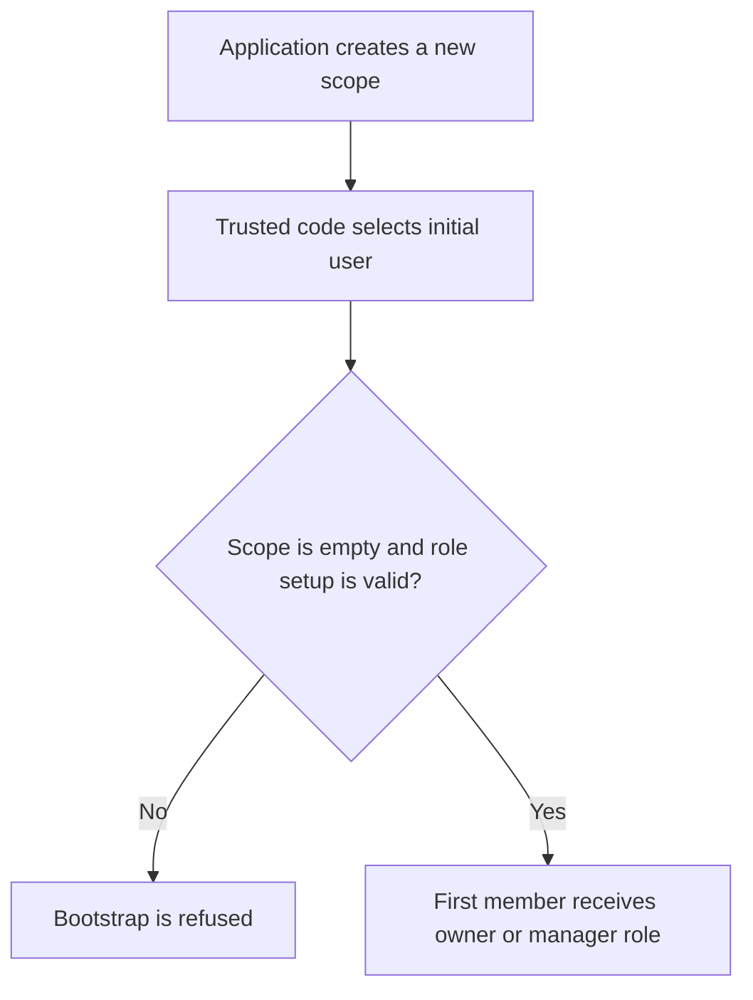

# US-ACCESS-21 — Bootstrap the first member of a scope

As an application operator or trusted scope-creation callback, I want to bootstrap the first member of a scope so that new scopes start with a valid and authorized first member.

**Status:** Current
**Access:** Trusted host code only; method accepts user/scope IDs without actor authorization.
**Entry:** After creating a new scope, host calls `memberships.createFirstMember` from trusted application code.
**Documentation:** [memberships.md](../docs/guide/memberships.md)
**Source:** [src/memberships.ts](../src/memberships.ts)
**Coverage:** [`tests/memberships_trusted.spec.ts`](../tests/memberships_trusted.spec.ts)

## Acceptance criteria

- Scope must have no existing memberships.
- With `ownerRole`, first member must take that role; without it, host must supply a role with `members:manage`.
- Method inserts membership and emits `membership.first_member` inside its transaction. Host must derive IDs from trusted context.

## User flow



## Code flow

Scope: package behavior and host callback boundary; the application owns its screens, scope records and transaction commit.

```mermaid
flowchart TD
    A["MembershipService.createFirstMember(input)"] --> B["resolve role from ownerRole or supplied manager role"]
    B --> C["start transaction; lock user and scope"]
    C --> D{"Scope empty and insert satisfies configured foreign keys?"
    D -->|No| E["throw input or SCOPE_NOT_EMPTY error"]
    D -->|Yes| F["insert membership and emit first_member"]
    F --> G["caller commits transaction"]
```

**Code references:** [createFirstMember](../src/memberships.ts), [trusted operations](../docs/guide/memberships.md)
