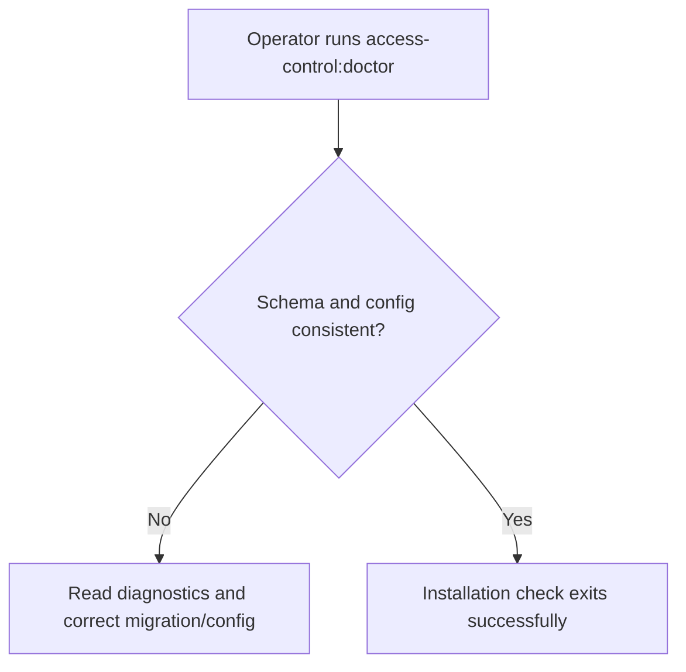
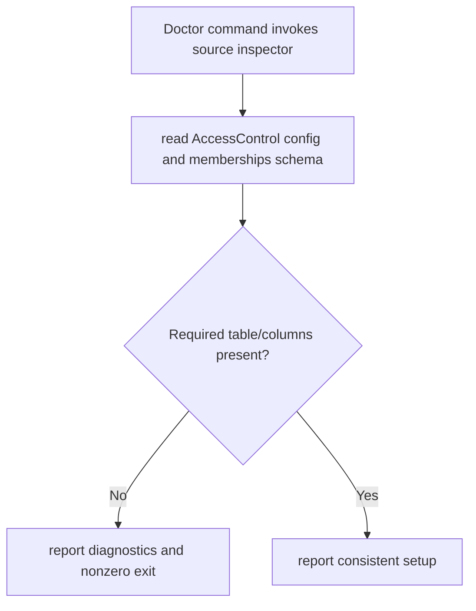

# US-ACCESS-22 — Diagnose the Access Control installation

As an application operator, I want to diagnose the access control installation so that the operator can find schema or configuration mismatches before traffic depends on them.

**Status:** Operator
**Access:** Operator runs diagnostic command against configured database/schema.
**Entry:** Run `node ace access-control:doctor` after migration and required setup.
**Documentation:** [setup.md](../docs/guide/setup.md)
**Source:** [src/doctor.ts](../src/doctor.ts)
**Coverage:** [`tests/doctor.spec.ts`](../tests/doctor.spec.ts)

## Acceptance criteria

- Doctor checks configured memberships table and required schema against config and reports whether setup is consistent.
- It does not validate every database index/type or replace operational checks; adoption guide says it checks table and columns, not types/indexes.

## User flow

## Code flow

Scope: package behavior and host callback boundary; the application owns its screens, scope records and transaction commit.

**Code references:** [doctor](../src/doctor.ts), [setup guide](../docs/guide/setup.md), [adoption limits](../docs/guide/adopting.md)
