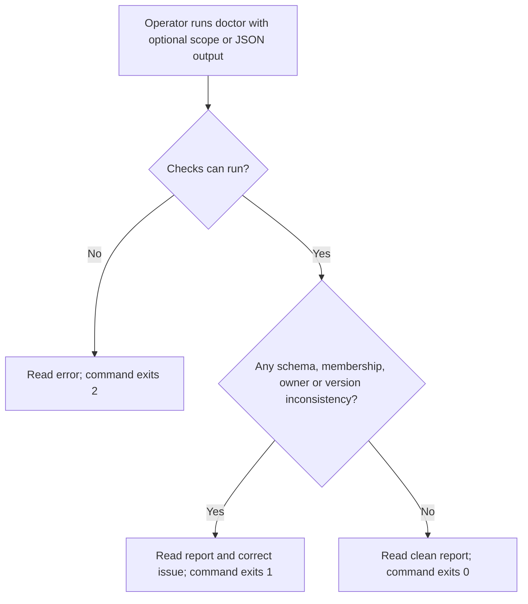
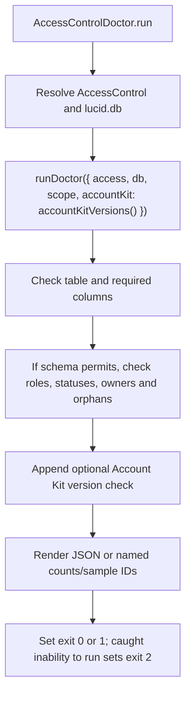

# US-ACCESS-22 — Diagnose the Access Control installation

As an application operator, I want to diagnose the access control installation so that the operator can find schema or configuration mismatches before traffic depends on them.

**Status:** Operator
**Access:** Operator runs diagnostic command against configured database/schema.
**Entry:** Run `node ace access-control:doctor [--scope=<id>] [--json]` after migration and required setup.
**Documentation:** [setup.md](../docs/guide/setup.md)
**Source:** [AccessControlDoctor](../commands/doctor.ts), [runDoctor](../src/doctor.ts)
**Coverage:** [`tests/doctor.spec.ts`](../tests/doctor.spec.ts)

## Acceptance criteria

- With no flags, the command checks all scopes and prints named results, counts and up to 20 sample IDs. Optional `--scope=<id>` restricts row checks to one normalized configured scope; `--json` prints the report as JSON.
- `runDoctor` checks that the configured memberships table and required columns exist, then checks exact known role/status strings and orphan user/scope references.
- When an owner role is configured, scopes represented by membership rows are checked for zero or multiple active owners. Scopes without any membership rows are outside that row grouping.
- The command supplies installed/expected Account Kit versions for a compatibility check. Direct `runDoctor` calls may omit that optional check.
- Exit code is 0 when checks are clean, 1 when checks find inconsistencies, and 2 when a check cannot run. The operation neither writes nor locks rows.
- It does not validate database column types or indexes, replace operational checks, or repair data; copy the published migration body and correct reported issues before cutover.

## User flow

## Code flow

Scope: read-only Ace command through package diagnostics and report presentation.

**Code references:** [AccessControlDoctor flags and run](../commands/doctor.ts), [runDoctor and accountKitVersions](../src/doctor.ts), [setup guide](../docs/guide/setup.md), [adoption limits](../docs/guide/adopting.md).
