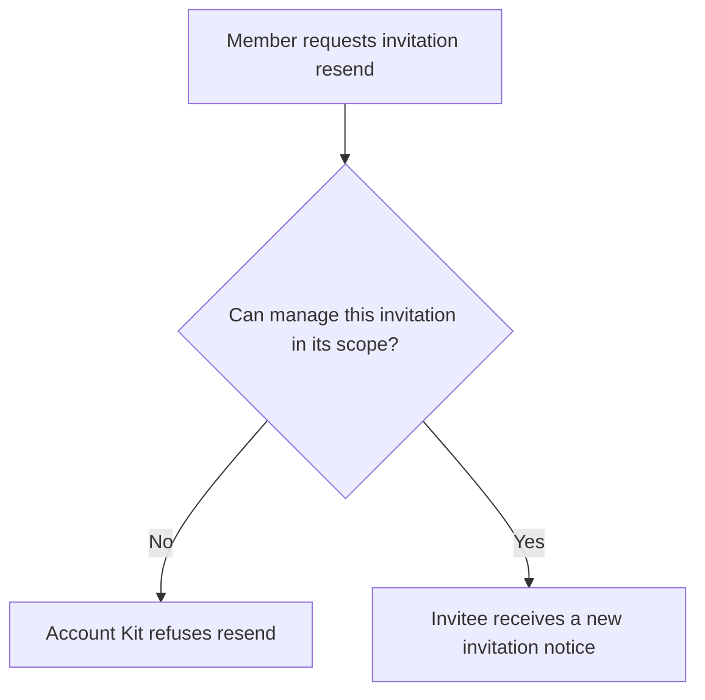
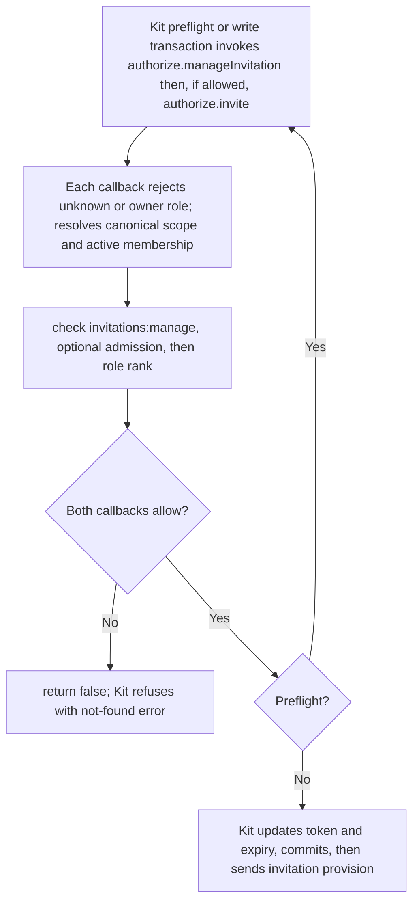

# US-ACCESS-23 — Resend a pending invitation

As an active member authorized to manage invitations, I want to resend a pending invitation so that authorized teammates can remind invitees without widening invitation authority.

**Status:** Current when Account Kit callback integration is configured
**Access:** Inviter must be admitted if enabled, active in canonical invitation scope, have `invitations:manage`, and be permitted to manage the invitation’s role.
**Entry:** Account Kit `invitations.resend` invokes `authorize.manageInvitation` and then `authorize.invite` for the invitation's role and scope, from the Access Control callbacks. Kit runs both in a preflight and again inside the write transaction.
**Documentation:** [account-kit.md](../docs/guide/account-kit.md)
**Source:** [account_kit/main.ts](../account_kit/main.ts)
**Coverage:** [`tests/account_kit.spec.ts`](../tests/account_kit.spec.ts)

## Acceptance criteria

- Callback checks the invitation’s own canonical scope and role, not a client-selected replacement.
- Unknown role, owner role, role above actor, missing membership/permission or failed admission denies resend.
- Access Control authorizes only; Account Kit replaces the token and expiry in the write transaction, then sends the replacement invitation notification after commit.
- Account Kit reports a denial from either callback as a not-found error (`E_ACCOUNT_KIT_INVITATION_MANAGEMENT_DENIED`, status 404).

## User flow

## Code flow

Scope: package behaviour and host callback boundary; the application owns its screens and scope records; Account Kit owns the transaction and its commit, and the package callback only authorizes.

**Code references:** [manageInvitation and invite callbacks](../account_kit/main.ts), [invitation rules](../docs/guide/account-kit.md), Account Kit 0.6.0 `resendInvitation`, `lockManagedInvitation` and `lockResendable` (invitation management service).
