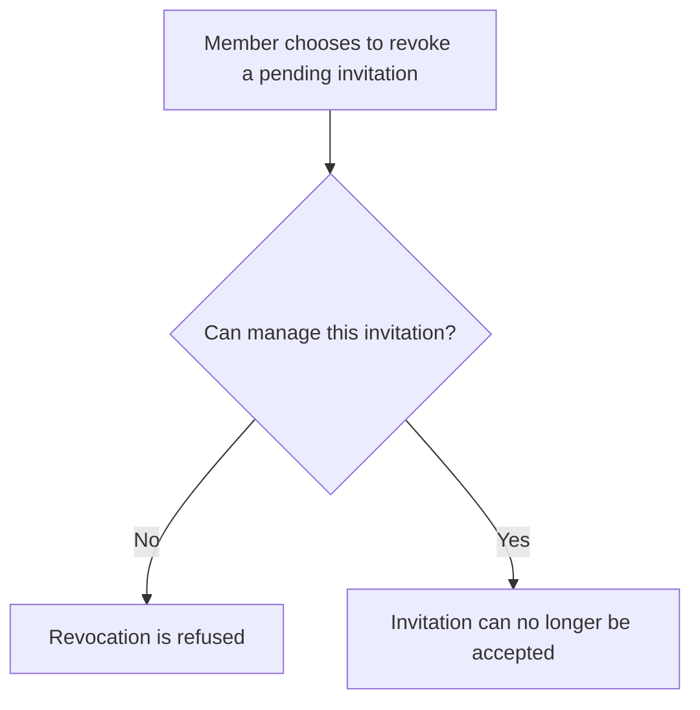
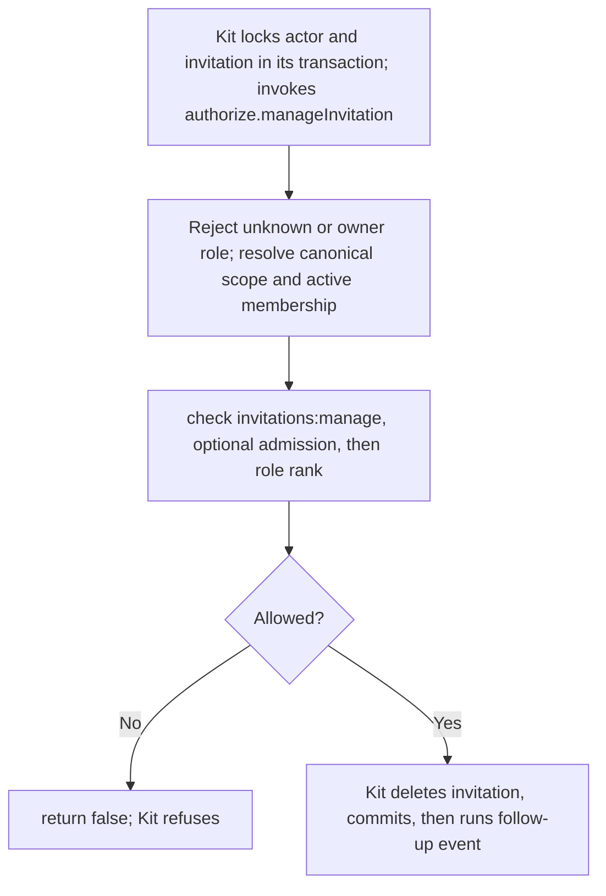

# US-ACCESS-24 — Revoke a pending invitation

As an active member authorized to manage invitations, I want to revoke a pending invitation so that authorized teammates can revoke invitations that should no longer be accepted.

**Status:** Current when Account Kit invitations are enabled and the relevant Access Control callback is wired
**Access:** Inviter must be admitted if enabled, active in canonical invitation scope, have `invitations:manage`, and be permitted to manage the invitation’s role.
**Entry:** `invitations.revoke({ actorId, invitationId })` invokes `authorize.manageInvitation` from Access Control callback.
**Documentation:** [account-kit.md](../docs/guide/account-kit.md)
**Source:** [account_kit/main.ts](../account_kit/main.ts)
**Coverage:** [`tests/account_kit.spec.ts`](../tests/account_kit.spec.ts)

## Acceptance criteria

- `invitationId` is a positive safe integer. Account Kit can revoke any retained invitation row the actor is permitted to manage, including an expired row.
- Callback checks the invitation’s own canonical scope and role before allowing revoke.
- Unknown role, owner role, role above actor, missing membership/permission or failed admission denies revoke.
- Access Control authorizes only; Account Kit deletes the invitation, then runs its lifecycle follow-up after committing. A follow-up failure leaves the invitation deleted.

## User flow

## Code flow

Scope: package behaviour and host callback boundary; the application owns its screens and scope records; Account Kit owns the transaction and its commit, and the package callback only authorizes.

**Code references:** [manageInvitation callback](../account_kit/main.ts), [invitation rules](../docs/guide/account-kit.md), [Account Kit revoke](https://github.com/Kevinjohn/oss-adonisjs-account-kit/blob/becffc90271b79c3ce6d2c1dfe0e0b3e871a9fc8/src/invitation_management.ts#L135-L157).
