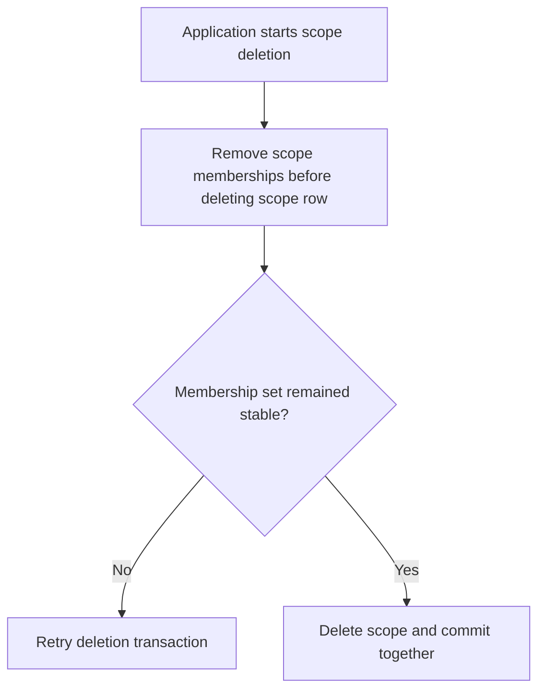
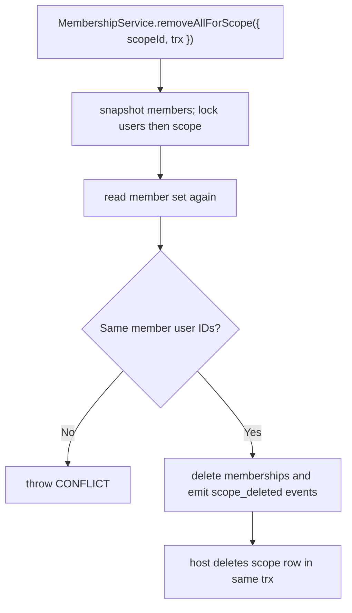

# US-ACCESS-25 — Remove memberships when deleting a scope

As an application operator, I want to remove memberships when deleting a scope so that scope deletion removes its memberships in the same host transaction and records each removal.

**Status:** Current when host scope deletion transaction calls the integration method
**Access:** Trusted application code; `removeAllForScope` requires caller transaction and does not authorize actor.
**Entry:** Before deleting the scope row, host calls `memberships.removeAllForScope({ scopeId, trx })` in same transaction.
**Documentation:** [memberships.md](../docs/guide/memberships.md)
**Source:** [src/memberships.ts](../src/memberships.ts)
**Coverage:** [`tests/memberships_trusted.spec.ts`](../tests/memberships_trusted.spec.ts)

## Acceptance criteria

- The method snapshots current member IDs, locks user rows then scope, and checks the set did not change.
- Concurrent membership-set change raises `E_ACCESS_CONTROL_CONFLICT`; host retries the whole deletion transaction.
- Membership rows and `membership.removed` events with reason `scope_deleted` share the host transaction. Optional actor is recorded in events only, not authorized by this method.

## User flow

## Code flow

Scope: package behavior and host callback boundary; the application owns its screens, scope records and transaction commit.

**Code references:** [removeAllForScope](../src/memberships.ts), [lock order](../src/locks.ts)
