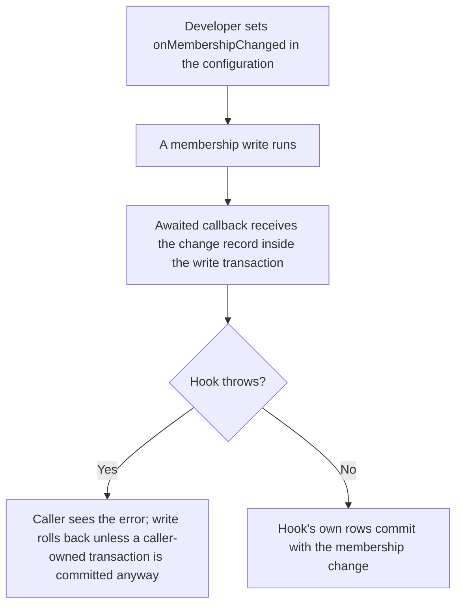
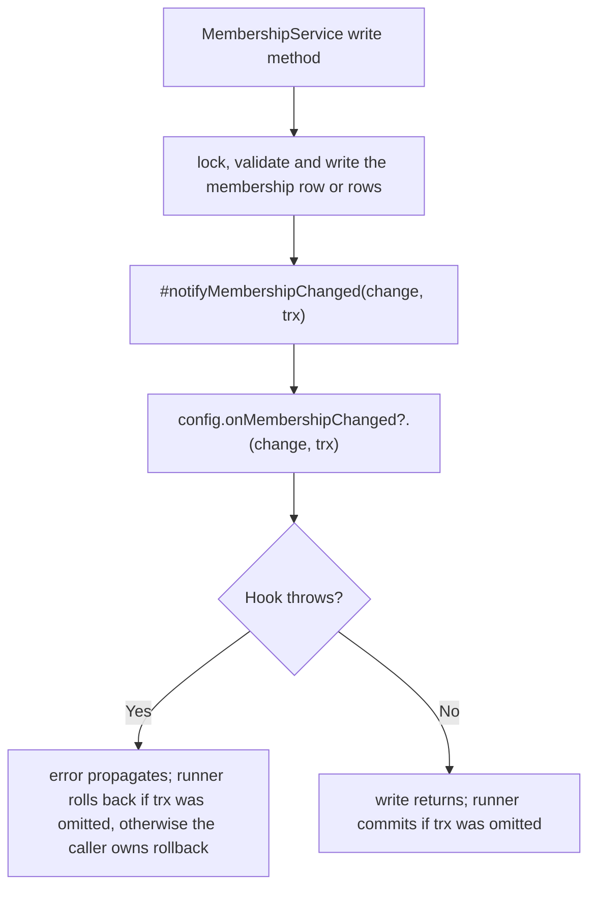

# US-ACCESS-26 — Audit or react to membership changes

As an application integrator, I want to audit or react to membership changes so that my own records or notifications follow every membership write.

**Status:** Current when `onMembershipChanged` is set in the configuration
**Access:** Application config author supplies the hook; the package calls it for every membership change made through its service, whoever the actor. Direct database writes are not observed.
**Entry:** `onMembershipChanged` property of the object passed to `defineAccessControl`.
**Documentation:** [memberships.md](../docs/guide/memberships.md#membership-change-callback)
**Source:** [hook type](../src/types.ts), [emit](../src/memberships.ts)
**Coverage:** [`tests/memberships.spec.ts`](../tests/memberships.spec.ts)

## Acceptance criteria

| Field    | Control                              | Required/default/conditions                                                                                                                                                                                                                                                                                                  |
| -------- | ------------------------------------ | ---------------------------------------------------------------------------------------------------------------------------------------------------------------------------------------------------------------------------------------------------------------------------------------------------------------------------- |
| `change` | Callback argument `MembershipChange` | `change.type` is one of `membership.added`, `membership.first_member`, `membership.invitation_accepted`, `membership.granted`, `membership.role_changed`, `membership.status_changed`, `membership.removed` (reason `removed`, `scope_deleted` or `account_deleted`), `membership.left`, `membership.ownership_transferred`. |
| `trx`    | Callback argument                    | The transaction of the write: the caller's when one was supplied, otherwise the runner's own.                                                                                                                                                                                                                                |

- The hook is optional; without it writes call nothing.
- It runs inside the write transaction after the row changes. A throw propagates out of the write method. When `trx` was omitted, the runner rolls the write back; when the caller supplied `trx`, the caller must let the error escape or roll back, because catching it and committing keeps the membership write.
- It must not lock or write other users' rows or Account Kit tables, which sit earlier in the lock order; writing application tables is allowed.
- A role or status update that changes nothing writes no row and makes no callback.

## User flow

## Code flow

Scope: package notification point and the host-supplied awaited callback; what the callback does with the change record is host-owned.

**Code references:** [Callback type](../src/types.ts), [notifyMembershipChanged](../src/memberships.ts), [callback guide](../docs/guide/memberships.md#membership-change-callback)
