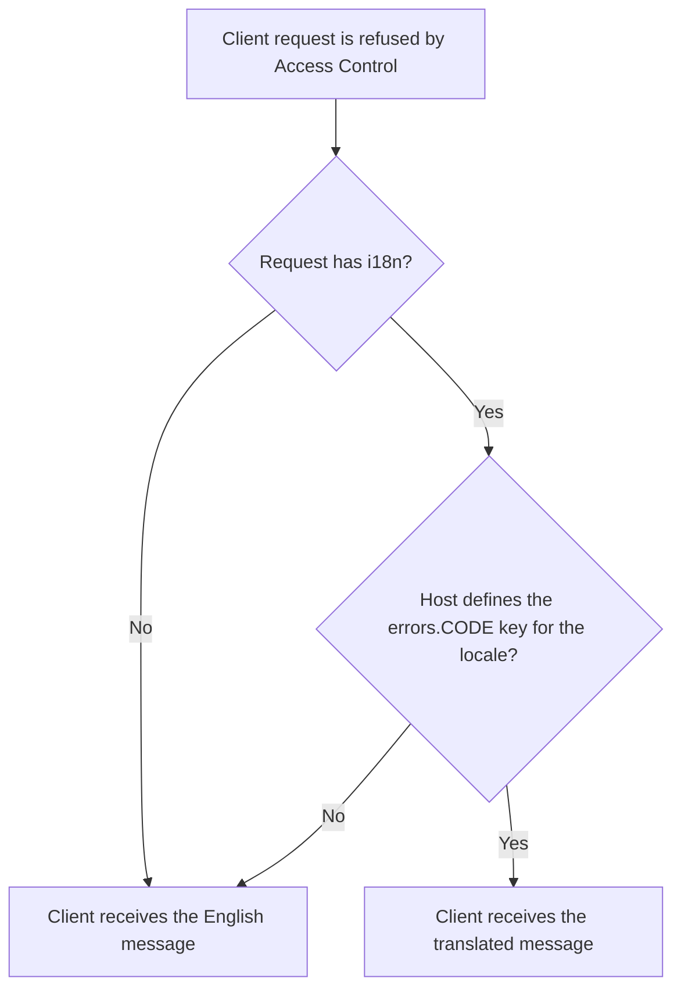
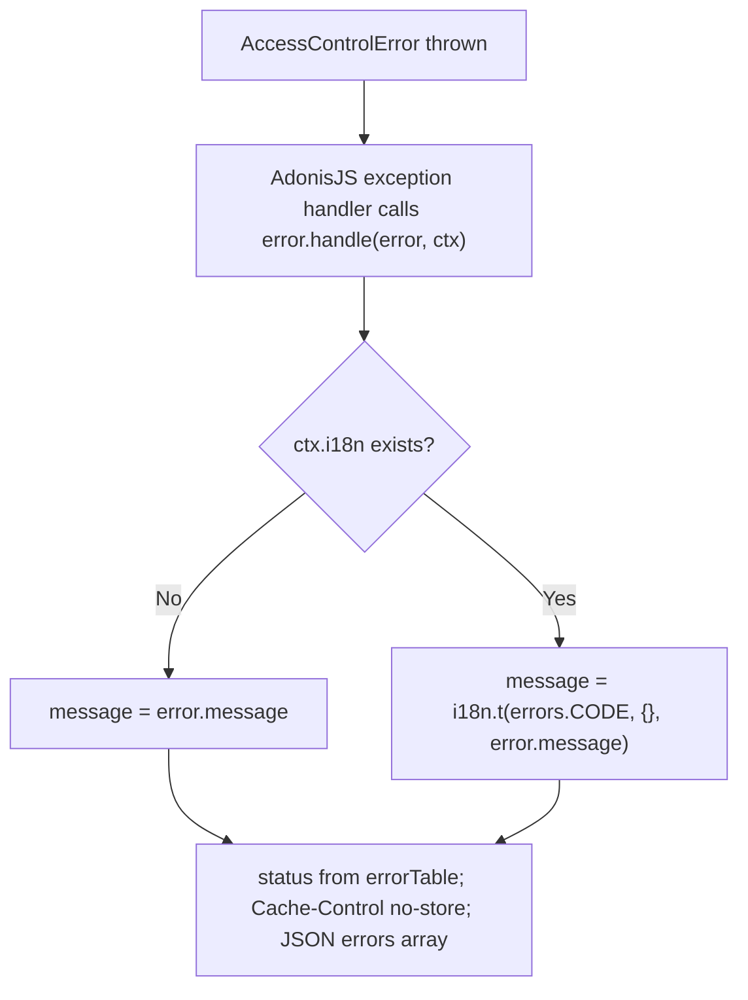

# US-ACCESS-27 — Localize Access Control error responses

As an application integrator, I want Access Control errors to be translated so that API clients see messages in their own language.

**Status:** Current; translation is opt-in and needs `ctx.i18n` (for example from `@adonisjs/i18n`)
**Access:** Any request whose handler lets an `AccessControlError` reach the AdonisJS exception handler; the application supplies the translations.
**Entry:** `AccessControlError.handle(error, ctx)`, called by the AdonisJS exception handler.
**Documentation:** [errors reference](../docs/reference/errors.md)
**Source:** [src/errors.ts](../src/errors.ts)
**Coverage:** [`tests/errors.spec.ts`](../tests/errors.spec.ts)

## Acceptance criteria

| Field                       | Control                           | Required/default/conditions                                                                                                             |
| --------------------------- | --------------------------------- | --------------------------------------------------------------------------------------------------------------------------------------- |
| `errors.<code>` translation | Host i18n key, one per error code | Optional; for example `errors.E_ACCESS_CONTROL_FORBIDDEN`. Missing keys return the English fallback. The package ships no translations. |
| `ctx.i18n`                  | Request context property          | Optional; without it the English message is sent.                                                                                       |

- The response status comes from `errorTable` for the code (for example 403 for `E_ACCESS_CONTROL_FORBIDDEN`, 404 for `E_ACCESS_CONTROL_NOT_A_MEMBER`).
- The body is `{ errors: [{ code, message }] }` with `Cache-Control: no-store`.
- With `ctx.i18n` the message is `ctx.i18n.t('errors.<code>', {}, <fallback>)`. The fallback is the error's own message: the table's English text, or a custom detail message where the package raised one.

## User flow

## Code flow

Scope: package error class and response handler; locale detection, translation files and the i18n provider are host-owned.

**Code references:** [errorTable](../src/errors.ts), [handle](../src/errors.ts), [errors reference](../docs/reference/errors.md)
