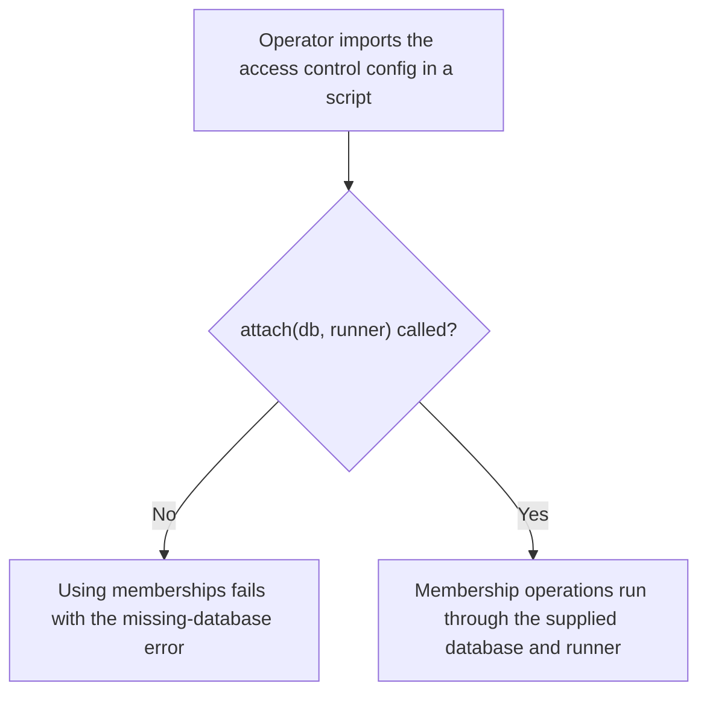
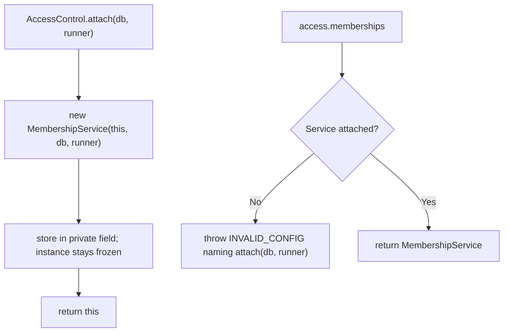

# US-ACCESS-28 — Attach Access Control without the provider

As an application operator, I want to attach the database and transaction runner myself so that scripts and non-provider code can use the membership service.

**Status:** Operator
**Access:** Application code that holds the `AccessControl` instance exported by `config/access_control.ts`, a Lucid `Database` and a transaction runner.
**Entry:** `access.attach(db, runner)`; the provider calls the same method at boot.
**Documentation:** [troubleshooting.md](../docs/guide/troubleshooting.md)
**Source:** [attach](../src/define.ts), [provider](../providers/access_control_provider.ts)
**Coverage:** [`tests/provider.spec.ts`](../tests/provider.spec.ts)

## Acceptance criteria

| Field    | Control             | Required/default/conditions                                                                                                                                                  |
| -------- | ------------------- | ---------------------------------------------------------------------------------------------------------------------------------------------------------------------------- |
| `db`     | Lucid `Database`    | Required; the connection the membership service reads and writes.                                                                                                            |
| `runner` | `TransactionRunner` | Required; `{ source: 'account-kit', transaction, lockRow, sqlTimestamp, readTimestamp }`. Account Kit's `@kevinjohn/adonisjs-account-kit/transaction` export has this shape. |

- `attach` returns the same `AccessControl` instance, now with `memberships` available.
- Reading `memberships` before any attach throws `E_ACCESS_CONTROL_INVALID_CONFIG` with a message that names `attach(db, runner)`.
- The provider path is unchanged: it attaches `lucid.db` and Account Kit's runner at boot.

## User flow

## Code flow

Scope: package instance binding; creating the database connection and runner is host-owned.

**Code references:** [attach and memberships getter](../src/define.ts), [provider register](../providers/access_control_provider.ts), [Account Kit runner](../src/kit_transaction.ts)
