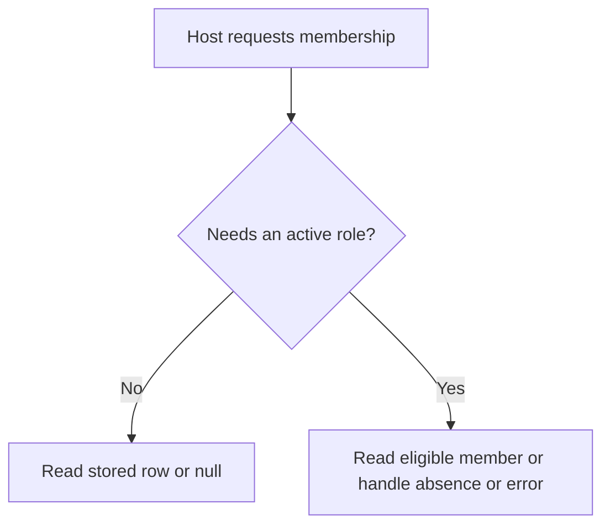
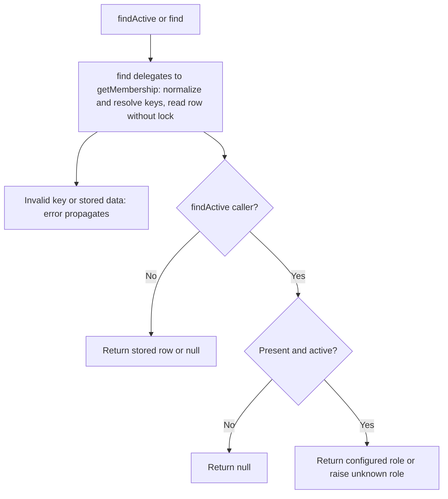

# US-ACCESS-29 — Read one membership

As a host application developer, I want to distinguish a stored membership from an eligible active member when loading a scope.

**Status:** Current
**Access:** Host supplies scope and user keys.
**Entry:** Call getMembership, find or findActive on access.memberships.
**Documentation:** [Guide](../docs/guide/memberships.md)
**Source:** [src/memberships.ts](../src/memberships.ts)
**Coverage:** [memberships.spec.ts](../tests/memberships.spec.ts), [membership_storage.spec.ts](../tests/membership_storage.spec.ts)

## Acceptance criteria

- getMembership and its alias find normalise the configured keys, resolve stored spelling and return a membership or null. Suspended rows are returned. These reads accept an optional transaction and acquire no locks. The host controls who may see the row.
- findActive returns null for absent or suspended rows. It returns a typed active membership for a configured role and raises E_ACCESS_CONTROL_UNKNOWN_ROLE for an active row outside the matrix.
- Invalid input keys fail validation. Invalid stored status or required timestamps raise E_ACCESS_CONTROL_INVALID_CONFIG.

## User flow

## Code flow

