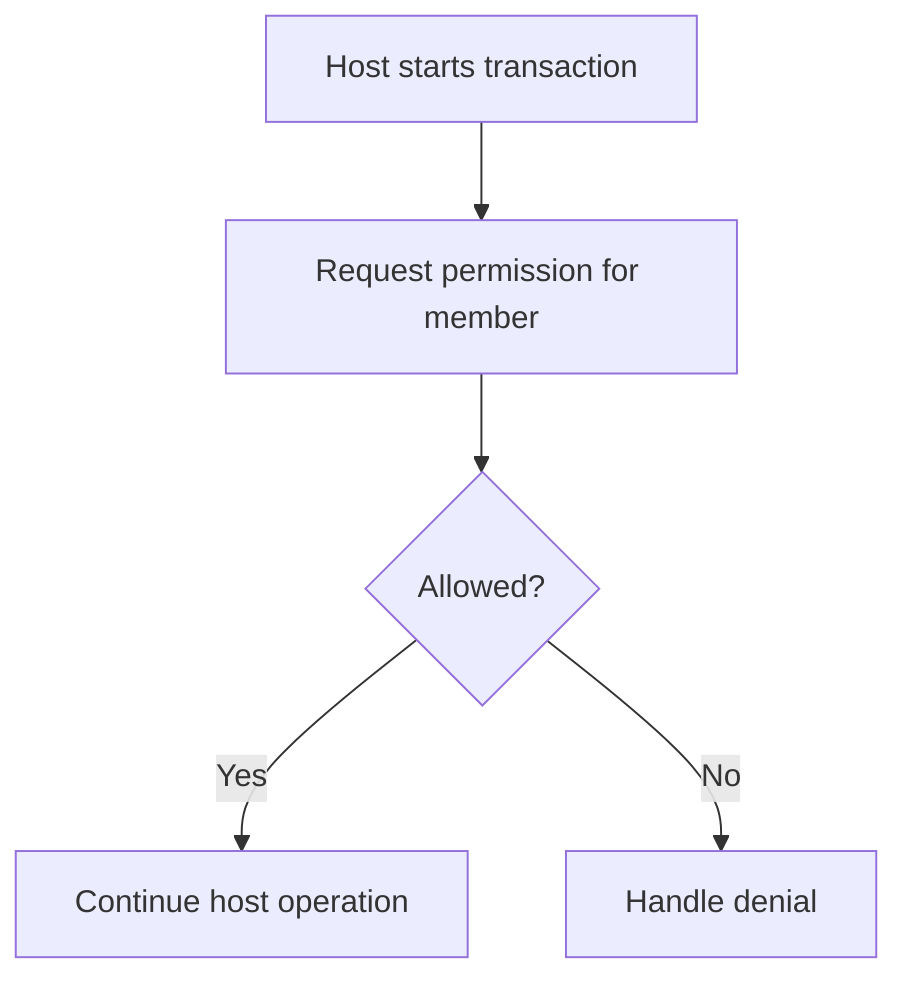
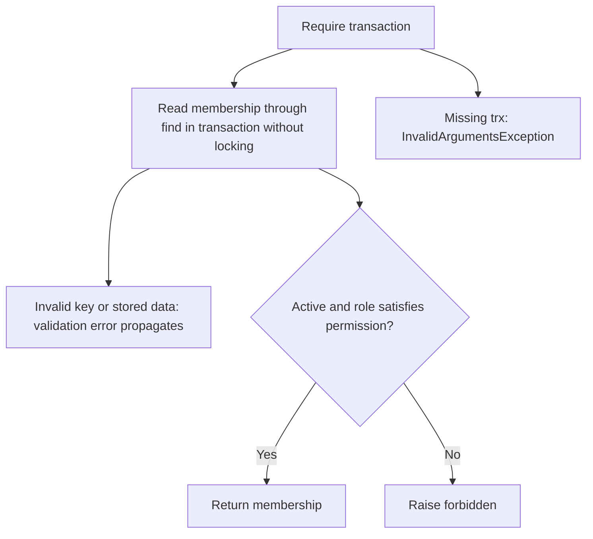

# US-ACCESS-30 — Authorise a service operation

As a host developer, I want to require a scoped permission inside my transaction before proceeding with a service operation.

**Status:** Current
**Access:** Host holds a transaction.
**Entry:** Call `memberships.authorize({ scopeId, userId, permission, trx })`.
**Documentation:** [Guide](../docs/guide/memberships.md)
**Source:** [src/memberships.ts](../src/memberships.ts), [src/rules.ts](../src/rules.ts)
**Coverage:** [memberships.spec.ts](../tests/memberships.spec.ts), [locks.spec.ts](../tests/locks.spec.ts)

## Acceptance criteria

- An active member whose configured role meets the permission threshold is returned to the caller.
- The service raises separate codes for an absent or suspended membership, unknown role, unknown permission and insufficient rank. It reads without locks in the caller transaction.
- A missing transaction raises AdonisJS's `InvalidArgumentsException`. A malformed key raises `E_ACCESS_CONTROL_INVALID_KEY`. Invalid stored status or timestamps raise `E_ACCESS_CONTROL_INVALID_STORED_STATUS` or `E_ACCESS_CONTROL_INVALID_STORED_TIMESTAMP`.
- The host still owns record-level policy and any subsequent write.

## User flow

## Code flow

**Code references:** [authorize](../src/memberships.ts#L450), [permission threshold](../src/rules.ts#L25).
