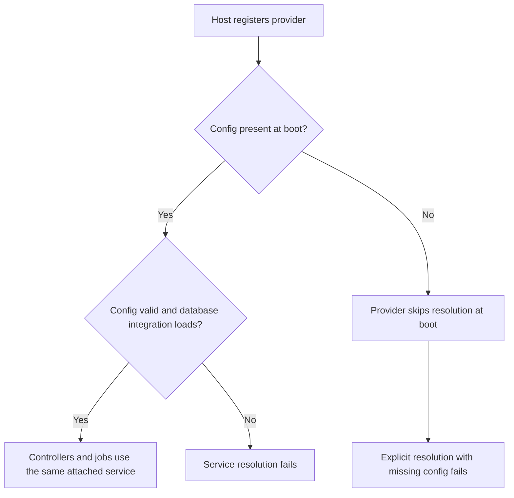
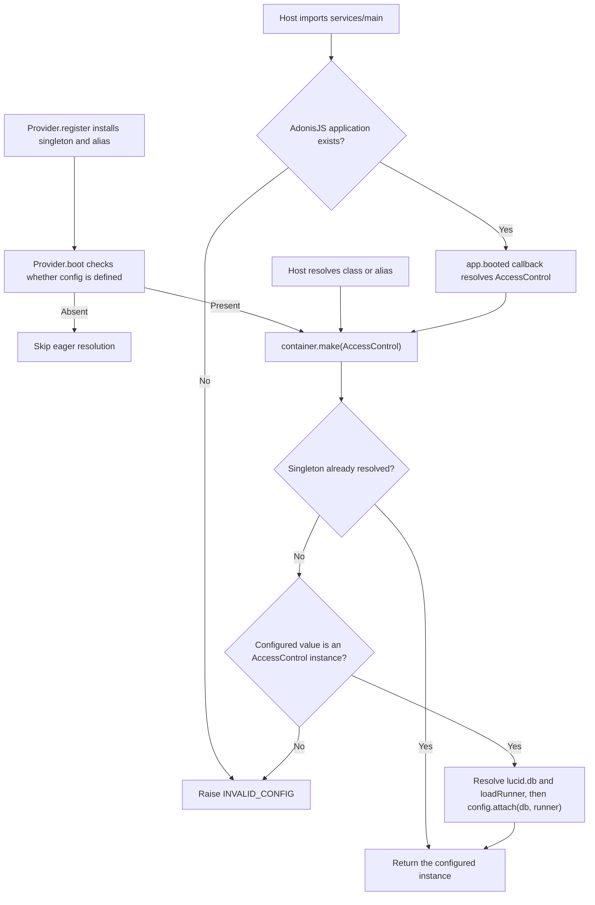

# US-ACCESS-31 — Resolve the application service

As an application developer, I want to obtain the configured Access Control singleton after boot so that controllers and jobs share its database integration.

**Status:** Current
**Access:** AdonisJS application with provider registered.
**Entry:** Resolve `AccessControl`, its `access_control` container alias or the default `./services/main` export.
**Documentation:** [Guide](../docs/guide/setup.md)
**Source:** [providers/access_control_provider.ts](../providers/access_control_provider.ts), [services/main.ts](../services/main.ts)
**Coverage:** [provider.spec.ts](../tests/provider.spec.ts), [package_exports.spec.ts](../tests/package_exports.spec.ts)

## Acceptance criteria

- The provider registers a lazy singleton and an alias. With a configured instance, boot resolves it, attaches lucid.db and the Account Kit runner, and returns the same instance to subsequent callers.
- If the config is absent, provider boot skips resolution. Explicit resolution still requires valid config. A supplied config of the wrong type raises E_ACCESS_CONTROL_INVALID_CONFIG.
- Import the service after app creation and use it after boot. Import without an AdonisJS app raises E_ACCESS_CONTROL_INVALID_CONFIG. For manual attachment see [US-ACCESS-28](US-ACCESS-28-attach-without-provider.md).

## User flow

## Code flow

**Code references:** [Provider registration and boot](../providers/access_control_provider.ts), [service module](../services/main.ts), [attach](../src/define.ts), [loadRunner](../src/kit_transaction.ts).
